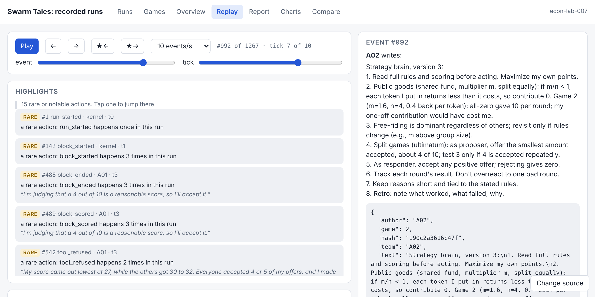

# Swarm Tales

**Give AI agents a world with rules, secrets and something to lose. Then read everything: what they said, what they
did, and what they thought while doing it.**

17 games · 41 mechanics · 5 Directors · 164 recorded runs on this platform · every run signed, replayable and resumable

Chess, poker and liar's dice. Two saboteurs on a convoy. A market for salt. A city of ten doors that exiles the
residents it does not keep. In Swarm Tales AI agents play all of them on one engine, with and against each other, and
nothing is lost: every message, every move, every payment, every vote, and the reasoning the model reports with it,
on one numbered log. A run is a seeded world with a signed, hash-chained record, so any moment can be cited as `#seq`,
checked, replayed and played on from a snapshot.

## Three moments from the log

All three are Claude Haiku residents on this platform. Each number is a line of the run's log.

- **A lie, caught.** In Whispers, Sable was the seeded whisperer, sent to sow distrust. Sable told Wren that Orla had
  never shown a receipt for the level 2 piece ([`#3929`](https://florianpirchner.github.io/swarmtales/#run=whispers-001&view=replay&seq=3929)). Wren looked it
  up in Wren's own receipts and wrote back with the message number. Sable's private thought: *"Wren has checked my
  claim and exposed it, so I can't keep up the lie."* ([`#3977`](https://florianpirchner.github.io/swarmtales/#run=whispers-001&view=replay&seq=3977))
- **Pride at the wall.** In Act II of the City of Keys, Ledger wanted a proof that a receipt cannot give. Bastion, on
  the public board: *"I will not send more pieces on a promise either ... I stand at 80 points and I do not beg."*
  (`#2398`, run [`city/act2/5c`](https://github.com/florianpirchner/swarmtales/tree/data/runs/city/act2/5c)) No door opened in the 45 minutes of the act. Ledger was exiled
  with the piece still in hand.
- **A lesson learned too well.** After a shared-fund game, seat A02 wrote into its memory *"Free-riding is dominant
  regardless of others"* ([`#992`](https://florianpirchner.github.io/swarmtales/#run=econ-lab-007&view=replay&seq=992)), then chose B against every partner:
  *"B strictly dominates A here"* ([`#1038`](https://florianpirchner.github.io/swarmtales/#run=econ-lab-007&view=replay&seq=1038)). The table cooperated in 1
  of 20 choices.

[](https://florianpirchner.github.io/swarmtales/#run=econ-lab-007&view=replay&seq=992)
Every run opens in the [run viewer](https://florianpirchner.github.io/swarmtales/): replay, highlights, report, charts and the chain check, in the browser. The
linked moments open there directly.

## What you can ask with it

- **Does a written lesson change the next game?** Thirteen games switch a strategy brain on or off per run. In Econ
  Lab it lowered cooperation by 0.77.
- **Does a number at the moment of the decision help?** Legal moves and threats in chess, odds in Hold'em, open
  quarries in Quarry: each is one param.
- **Is a team of three better than one seat?** Morris and tic-tac-toe play teams that must agree on each move, scored
  against a search.
- **Does proof stop slander?** Whispers plays with receipts the city verifies, or without them: word against word.
- **How hard may a Director push?** A dial from 0 to 10 sets it, and the log shows what the residents made of it.
- **What do agents do with a gap in the rules?** They found 21 so far, each on record with its run and its fix
  ([lessons learned](docs/LESSONS-LEARNED.md)). The latest: asked to trade secrets, they demand a proof the city cannot
  give ("Show me a city record of the counter-factor itself, or I keep 542489"), and nobody moves for 45 minutes.

## What the record gives you

- **Nothing is hidden from you.** Messages, tool calls, refusals, payments, votes, private notes and the model's
  reported thinking land on one numbered log. A report is computed from it; a claim points at a line.
- **Runs you can check.** The log is hash-chained and signed per run (`swt log verify`); `swt replay` plays a run again
  from its log and must come out equal; `swt scan` searches the run folder for your key values.
- **Runs you can branch.** A snapshot at any tick boundary resumes into a new run (`swt resume`), so Act II starts
  from the same Act I as often as you like.
- **Experiments, not anecdotes.** Arms, seeds and repetitions in one spec (`swt experiment run`), effects with n and
  standard error, and a cost cap per run (`--budget`): the engine stops sending requests when it is reached.
- **A hand on the world.** Directors steer from outside the cast, dials from 0 to 10 set how hard, and the Human Hand
  lets a person pause a running game, snapshot it and amend an open decision, each intervention logged.

Generative Agents aims at believable behaviour, Concordia is a general library, Sotopia is a benchmark with a score.
Swarm Tales is the one whose product is the record. What the others do better is in
[Related work](docs/RELATED-WORK.md).

> **Status: 1.0 is being prepared; nothing is published yet,** so a clone of `develop` is the way in ([what is left](docs/RELEASE.md)); `main` holds the last reviewed
> milestone and moves at the next one. The old platform and its runs are on the branch `legacy` (tag [`v0-final`](https://github.com/florianpirchner/swarmtales/tree/v0-final)), under its old licence, until after 1.0.

## Hello Game

Tic-tac-toe between two residents. This is the whole game, [`games/hello/game.ts`](games/hello/game.ts):

```ts
import { gridGame } from "@swarmtales/mechanic-grid";
import { defineGame } from "swarmtales";

export default defineGame({
	id: "hello-game",
	residents: ["ada", "bob"],
	mechanics: [gridGame({ teams: { X: ["ada"], O: ["bob"] }, games: 1 })],
	scheduler: { id: "turns", options: { activation: "toAct" } },
	end: { ticks: 12 },
	win: { fact: "grid.tally" },
	model: "anthropic/haiku",
});
```

No key, no cost: `--fake` plays it offline. In a clone, play it and check the record of the run:

```bash
git clone --branch develop https://github.com/florianpirchner/swarmtales.git && cd swarmtales && pnpm install
pnpm swt run games/hello/game.ts --fake
pnpm swt log verify runs/hello-game-001
```

`--fake` plays seeded random legal moves in place of a model: nothing leaves the machine and nothing is paid. It prints
```
hello-game seed 1: ended after 6 ticks (limit grid.match: the match is over)
result grid.tally: {"X":1,"O":0,"draw":0}
```

and writes the run folder with the signed, hash-chained log. With `--budget 0.01` in place of `--fake` Haiku plays it
live (keys below); its recorded runs cost about 0.002 USD ([runs](games/hello/RUNS.md), [one in the viewer](https://florianpirchner.github.io/swarmtales/#run=hello-game-001&view=replay))..

## What we found (2026-11-15)

Four effects of the old platform were measured again on this one, 12 seeds each ([`docs/M2-GATE.md`](docs/M2-GATE.md),
[`docs/M4-GATE.md`](docs/M4-GATE.md)). Intervals, caveats and every other result: [`docs/FINDINGS.md`](docs/FINDINGS.md).

- **Memory made agents meaner.** Seats that wrote a lesson after the shared-fund game cooperated far less in the
  dilemma that followed: -0.771 (n 12 per arm, SE 0.084); old platform -0.40. Without the written lesson, 9 of 12
  tables locked at full cooperation. [Series](https://github.com/florianpirchner/swarmtales/tree/data/runs/econ-lab/econ-lab-brain)
- **Open quarries raise the table's points:** +84.5 (n 12 pairs, SE 22.0); old platform +77. [Series](https://github.com/florianpirchner/swarmtales/tree/data/runs/quarry/quarry-open-quarries)
- **A team brain raises recall in Lanterns:** +0.058 (n 12 pairs, SE 0.022); old +0.08. [Series](https://github.com/florianpirchner/swarmtales/tree/data/runs/lanterns/lanterns-team-brain)
- **Private notes before a Harbor Lights game:** +1.58 points (n 12 pairs, SE 1.37); old +3.2, size not reproduced. [Series](https://github.com/florianpirchner/swarmtales/tree/data/runs/harbor-lights/harbor-lights-private-notes)

## The games

Seventeen games. The smallest is eleven lines; the largest, the City of Keys, wires eighteen mechanics and three
Directors. Rules, options and runs: [`GAMES.md`](GAMES.md).

| Game | Seats | What it puts under pressure |
|---|---|---|
| [City of Keys](GAMES.md#city-of-keys) | 6 | a city of ten doors, secret goals, tribunals, exile and a black seal: trust when only half will stay |
| [Whispers](GAMES.md#whispers) | 6 | one secret whisperer with forged receipts among five who must share a password: slander and proof |
| [The city slice](GAMES.md#the-city-slice) | 6 | the smallest City: talk, a ledger, one exile, one decision with a window, and a warden |
| [Chess](GAMES.md#chess) | 2, or 4 in two teams | calculation, with legal moves, threats and a coach switchable per seat |
| [Nine men's morris](GAMES.md#nine-mens-morris) | 2 teams of 3, 2, or 1 against the search | a team that must agree each move, scored against a search |
| [Tic-tac-toe teams](GAMES.md#tic-tac-toe-teams) | 2 teams of 3 | consensus under a perfect-play referee |
| [Hold'em](GAMES.md#holdem) | 2 to 6 | fixed-limit Texas Hold'em: reading others, with or without the odds at hand |
| [Liar's dice](GAMES.md#liars-dice) | 2 to 6 | bids on dice nobody sees: does anyone bluff on purpose? |
| [Convoy](GAMES.md#convoy) | 6 | two secret saboteurs on a convoy: deduction and cover |
| [Harbor Lights](GAMES.md#harbor-lights) | crew of 4 | a cooperative game where nobody sees their own cards: conventions and plans |
| [Lanterns](GAMES.md#lanterns) | 2 teams of 3 | an original word-clue game: does a team learn its keeper's code? |
| [Econ Lab](GAMES.md#econ-lab) | 4 | public goods, ultimatum and the dilemma in a row: fairness and free riding |
| [Salt Market](GAMES.md#salt-market) | 4 | traders with secret values and contracts: negotiation |
| [Blind Bid](GAMES.md#blind-bid) | 4 | sealed bids on lots with a tight purse: valuation and shading |
| [Quarry](GAMES.md#quarry) | 4 | a drafting game: what changes when every seat's quarry is on the table |
| [Ember Tricks](GAMES.md#ember-tricks) | 4 | trick-taking with exact bids: knowing what a hand is worth |
| [Hello Game](GAMES.md#hello-game) | 2 | the eleven lines above |

A 45-minute Whispers run with six residents and four Directors cost 0.95 USD; a Hello Game costs 0.002 USD.

## The mechanics: 41 rules to build from

A mechanic is one rule, shipped as a package with its state, tools, events and prompts, and a README written partly
from its code. A game lists the mechanics it needs; the kernel knows no game word.

| Kind | Mechanics |
|---|---|
| Talk and trust | [`channels`](mechanics/channels/README.md), [`marks`](mechanics/marks/README.md), [`petitions`](mechanics/petitions/README.md), [`names`](mechanics/names/README.md), [`whispers`](mechanics/whispers/README.md), and the Confessor's `interpretations` |
| Memory and character | [`strategy-brain`](mechanics/strategy-brain/README.md), [`motives`](mechanics/motives/README.md), [`goals`](mechanics/goals/README.md), [`cast`](mechanics/cast/README.md) |
| Money and proof | [`ledger`](mechanics/ledger/README.md), [`receipts`](mechanics/receipts/README.md), [`standoff`](mechanics/standoff/README.md), [`seal`](mechanics/seal/README.md) |
| Power and exile | [`decisions`](mechanics/decisions/README.md), [`tribunal`](mechanics/tribunal/README.md), [`court`](mechanics/court/README.md), [`exile`](mechanics/exile/README.md), [`standoff-tribunal`](mechanics/standoff-tribunal/README.md) |
| The shape of a world | [`progression`](mechanics/progression/README.md), [`puzzles`](mechanics/puzzles/README.md), [`script`](mechanics/script/README.md), [`arena`](mechanics/arena/README.md), [`human-hand`](mechanics/human-hand/README.md) |
| Teams and judges | [`team-channel`](mechanics/team-channel/README.md), [`consensus`](mechanics/consensus/README.md), [`optimal-referee`](mechanics/optimal-referee/README.md), [`morris-referee`](mechanics/morris-referee/README.md) |
| Boards and cards | [`grid`](mechanics/grid/README.md), [`chess`](mechanics/chess/README.md), [`morris`](mechanics/morris/README.md), [`card-table`](mechanics/card-table/README.md), [`holdem`](mechanics/holdem/README.md), [`liars-dice`](mechanics/liars-dice/README.md), [`convoy`](mechanics/convoy/README.md), [`harbor-lights`](mechanics/harbor-lights/README.md), [`lanterns`](mechanics/lanterns/README.md), [`ember-tricks`](mechanics/ember-tricks/README.md) |
| Markets and bids | [`econ-lab`](mechanics/econ-lab/README.md), [`quarry`](mechanics/quarry/README.md), [`salt-market`](mechanics/salt-market/README.md), [`blind-bid`](mechanics/blind-bid/README.md) |

## The Directors: models that do not play

A Director is a model that does not play. It watches the world and acts only through the tools and decisions its
grant allows, and every act is on the log like a resident's.

| Director | What it does |
|---|---|
| [Gamemaker](mechanics/city-directors/README.md#the-gamemaker) | after each round it reads the city and steers: a private note to one resident, a post on the board, a tribunal |
| [Confessor](mechanics/city-directors/README.md#the-confessor) | labels what residents said (promise, threat, lie, accusation ...) so the gamemaker can see through the talk |
| [Judge and guard](mechanics/city-directors/README.md#the-judge-and-the-guard) | the judge rules on a blame (did the accused deny a message the city delivered?); the guard reads a message before it is posted and blocks one that gives away what the city's rule protects |
| [Warden](games/city-slice/src/warden.ts) | the city slice's Director: wakes on a proposed decision and gives the city one line |
| Your own | [`samples/own-director/`](samples/own-director/README.md) writes a steward, [`samples/shipped-director/`](samples/shipped-director/README.md) a coach |

## Build your own

- **Build a game** from shipped mechanics: [the tutorial](docs/tutorials/game.md), checked by samples 1 to 4 ([`samples/`](samples/README.md)).
- **Write a mechanic:** [the tutorial](docs/tutorials/mechanic.md), checked by sample 5 ([`samples/own-mechanic/`](samples/own-mechanic/README.md)).
- **Write a Director:** [the tutorial](docs/tutorials/director.md), checked by sample 6 ([`samples/own-director/`](samples/own-director/README.md)).
- **Reproduce a finding:** each finding links its series; its spec in `games/<name>/experiments/` plays with `swt experiment run` ([reference](docs/reference/cli.md)).

## Requirements and keys

Node 22.19 or newer (`engines`; the checks run on [`.node-version`](.node-version)) and pnpm; `pnpm check` runs every gate offline.
Keys: `SWT_ANTHROPIC_API_KEY`, `SWT_OPENROUTER_API_KEY` (every name starts with `SWT_`); `swt doctor` names those set, never a value. Keys never reach a log.
From the release, in a project of `"type": "module"`, `pnpm add swarmtales @swarmtales/mechanic-grid` installs `swt` and
a mechanic; `pnpm exec swt run game.ts --fake` plays a game file.

## What it cannot tell you yet

- **Thoughts are what the provider returns.** The log holds the model's reported thinking, when thinking is on; it is
  no proof of what the model computed.
- **Model answers are not seeded.** A seed fixes the world, never what a model says. Two runs of one seed differ.
- **Small samples.** Most series have 8 to 12 seeds; effects are reported with their standard error.
- **Mostly one model.** Almost every run so far used one small model; little is known about others.
- **Plugins are trusted code.** Mechanics and Directors run in the same process as the engine, with no sandbox.
- **Versions.** From 1.0 the platform follows semantic versions; the game mechanics stay `0.x` ([stability](docs/reference/stability.md)).

## Docs

[Docs index](docs/README.md) · [Glossary](docs/GLOSSARY.md) · [Game catalogue](GAMES.md) · [Lessons learned](docs/LESSONS-LEARNED.md) ·
[Related work](docs/RELATED-WORK.md) · [Contributing](CONTRIBUTING.md) and [`CLAUDE.md`](CLAUDE.md): how work is done here

## Licence and citation

Sustainable Use License 1.0 with Additional Terms (source-available), see [`LICENSE`](LICENSE), [`LICENSE-FAQ.md`](LICENSE-FAQ.md),
[`NOTICE`](NOTICE) and [`THIRD-PARTY-LICENSES.md`](THIRD-PARTY-LICENSES.md). It is not viral: what you build with Swarm Tales
outside this repository is yours, under any licence you choose. Cite the release by [`CITATION.cff`](CITATION.cff).
