# How it works

The technical side of Swarm Tales: the harness, its roles and models, how to run a story, the
artifacts a run leaves behind, and the rules for code. The story of the project is in the
[README](../README.md).

LLM agents live in a closed city, compete for a few survival slots and can only progress by
exchanging information with each other. The arena is a **story generator**: a good run leaves
an event log full of alliances, trust, deception and betrayal, and every beat can be traced to
concrete tool calls and messages.

The harness is written in TypeScript on top of
[`@earendil-works/pi-ai`](https://www.npmjs.com/package/@earendil-works/pi-ai) and
[`@earendil-works/pi-agent-core`](https://www.npmjs.com/package/@earendil-works/pi-agent-core).

## Overview



<sub>Source: [`docs/overview.mmd`](overview.mmd) (Mermaid), rendered to SVG.</sub>

A run is a closed city of six competitors. Every minute the **harness** runs one round of three
passes:

- **Competitors.** In every pass, each LLM agent with something new (or with tool results it has
  not answered yet) gets one step: its turn input, one model call and that call's tool calls. It
  acts only through tools: it submits codes, posts on the board, sends DMs, works in groups and
  moves points. The order is reshuffled in every pass, so a DM can go back and forth three times a
  minute.
- **Director.** The director plays the story's scripted beats: courier lines, city factors, the
  feast and the standings.
- **City.** The engine numbers every message, sends DM receipts, settles blames and, in a story
  with a tribunal, calls it (the first on progress, later ones as the game master plans them,
  within guard rails), runs the faction draft, holds the secret votes, keeps the gate and exiles,
  and ends the act once it has exiled its target.
- **Classifier.** After the round, the statement classifier labels what the competitors wrote and
  thought, for example promise, offer, threat, refusal, lie, hesitation, help request, accusation
  or thanks.
- **Game master.** It reads a redacted situation report and decides whether to intervene with a
  private note or a board post. It never sees a password, fragment or factor. It sees thoughts
  only as labels and may use a private read only towards that resident.

Everything lands in an append-only event log. The deterministic **digest** turns that log into
beats, relationships and a timeline, and the **run reporter** writes a first-draft `REPORT.md`
from it. A **snapshot** freezes a run after an act, so later acts
start without replaying the earlier ones.

| Role | Model in our runs | Provider | Notes |
|---|---|---|---|
| Competitors | `claude-haiku-5-5` (Haiku) | Anthropic (`--provider anthropic`) | the nexus story's own default is `z-ai/glm-5.3-flash` via OpenRouter |
| Game master | `deepseek/deepseek-v4.1-flash-1017` | OpenRouter | fixed in the story; `--gamemaster-provider/--gamemaster-model` override it |
| Statement classifier | `claude-haiku-5-5`, thinking off | Anthropic | optional `perplexity/pplx-decider-v1.2` via OpenRouter (`--classifier-provider/--classifier-model`), cheaper but less precise targets |
| Digest chronicle (optional) | chosen with `--provider/--model` | any | only with `pnpm digest --chronicle` |
| Reporter | DeepSeek V4.1 Flash (`deepseek/deepseek-v4.1-flash-1017`) | OpenRouter | writes the first draft of `REPORT.md` after every run; `--reporter-provider/--reporter-model` override it, `--no-reporter` turns it off |
| Tests and offline runs | scripted provider | none | no API key, no cost |

| Document | Content |
|---|---|
| [`docs/SPEC.md`](SPEC.md) | game specification (normative for behavior) |
| [`docs/ARCHITECTURE.md`](ARCHITECTURE.md) | layout, story DSL, coding rules, milestones |
| [`docs/MODELS.md`](MODELS.md) | model candidates, prices, metrics |
| [`stories/nexus/`](../stories/nexus/) | the nexus story: code (`story.ts`) and a short overview |
| [`docs/STORY-NEXUS.md`](STORY-NEXUS.md) | the full nexus story: acts, levels, feast, director beats, personas |
| [`examples/nexus-act1-06a-02/`](../examples/nexus-act1-06a-02/) | a recorded Act I with digest and an Act I snapshot to resume from (the Act II base since v05) |
| [`examples/nexus-act1-06a-01/`](../examples/nexus-act1-06a-01/) | the older recorded Act I, base of Act II runs v01-v04 and of the snapshot tests |
| [`examples/nexus-act2-06a/`](../examples/nexus-act2-06a/) | versioned Act II runs, all resumed from that snapshot |

## Quick start

Requires Node 22 or newer and pnpm.

```bash
pnpm install
pnpm test                                       # all tests, offline, no API key
pnpm start --provider scripted --minutes 5      # offline run with scripted agents
pnpm start                                      # the nexus story with the story's model
```

Every check that CI runs:

```bash
pnpm typecheck   # tsc, strict, including type-level tests of the story DSL
pnpm lint        # ESLint with typescript-eslint strictTypeChecked + stylisticTypeChecked
pnpm test        # vitest, offline with the scripted provider
pnpm validate    # validates every registered story
```

## Running a story

```bash
pnpm start --story nexus                    # default story, 6 agents, 60 minutes, seed 7
pnpm start --minutes 20 --seed 3            # override run parameters
pnpm start --agents 12                      # agent count must fit every team layout
pnpm start --only 4 --agents 3              # play only level 4 and stop when everyone passed it
pnpm start --level 5                        # start on level 5 and keep playing
pnpm start --stop-when-done                 # stop once every competitor passed the last level
pnpm start --passes 2 --block-size 3        # two passes a minute, three concurrent model calls per block
pnpm start --provider deepseek --model deepseek-flash
pnpm start --provider anthropic --minutes 6   # Claude Haiku 5.5 via the Anthropic API
pnpm start --snapshot-after 7 --stop-after-snapshot   # save the run once everyone passed level 7
pnpm start --resume runs/run-001/snapshot-L7.json     # continue from that snapshot
```

Flags override the story's run parameters: `--story --agents --minutes --seed --provider
--model --level --only --stop-when-done --passes --block-size --no-personas --no-gamemaster --gamemaster-provider --gamemaster-model --no-classifier --runs
--snapshot-after --stop-after-snapshot --resume --no-reporter --reporter-provider --reporter-model`.
`--passes <n>` sets the story's `run.passesPerMinute` (1 to 5; nexus: 3): in every pass each
competitor gets at most one step, one model call with its tools. `--block-size <n>` sets
`run.blockSize` (nexus: 1): a block's model calls run concurrently, which shortens a live minute,
while their tools still run in the seeded order (SPEC 3). `--no-personas`
plays a control group without personas. `--no-gamemaster` plays without the story's LLM game
master (SPEC 10.4); nexus uses DeepSeek V4.1 Flash via OpenRouter for it, so it needs `OPENROUTER_API_KEY`
(`--gamemaster-provider anthropic --gamemaster-model haiku` switches it to Haiku).
`--no-classifier` plays without the statement classifier (SPEC 10.5), which labels every round's
statements and thoughts (promise, threat, refusal, ...) for the digest and the game master. It uses
Haiku via Anthropic (`ARENA_ANTHROPIC_API_KEY`); `--classifier-provider openrouter --classifier-model perplexity/pplx-decider-v1.2` switches
it to a structured classifier model.

`--provider scripted` needs no key. Its competitors read their solution from the world's
observer view and submit it, so a whole run, including all artifacts, can be exercised offline.

### Warm start for Act II (snapshots)

`--level 8` starts everyone cold on level 8: no history, no points, no relationships. To play Act II
after a real Act I instead, save Act I once and resume it as often as you like (SPEC 17):

```bash
pnpm start --provider anthropic --snapshot-after 7 --stop-after-snapshot
# > snapshot after level 7 (round 23): runs/run-004/snapshot-L7.json
pnpm start --resume runs/run-004/snapshot-L7.json                 # Act II with the story's models
pnpm start --resume runs/run-004/snapshot-L7.json --provider deepseek --minutes 50
```

A recorded Act I (Haiku, seed 7) ships with the repo, so you can skip the first step:
`pnpm start --resume examples/nexus-act1-06a-02/snapshot-L7.json --provider anthropic`
(see [`examples/nexus-act1-06a-02/`](../examples/nexus-act1-06a-02/)).

`--snapshot-after <n>` shuts a door after level n. Whoever passes level n gets the reward and the
receipt as usual but waits at the door: still on level n with its tools (to watch and help), with
a city notice that the next door opens once every resident has passed level n. Level n+1 is not
dealt and none of its rules fire. Once everyone waits, `snapshot-L<n>.json` is written into the
run directory at that round boundary (after the classifier and the game master looked).
`--stop-after-snapshot` ends the run there; without it everyone enters level n+1 together at the
next minute and the run plays on. The snapshot holds the whole world (levels, points and ledger,
solved levels, wrong attempts, unlocked tools, marks, groups and treasuries, board, mailboxes and
notices, DMs, receipts, cast and collections, petitions, teams and puzzles), the director's firing
state, every competitor's model context, the game master's notes and tracks, the classifier's
conversation context and every event so far.

`--resume <file>` continues with exactly that state at the next minute, where everyone waiting at
the door enters level n+1. The new run's `events.jsonl` starts with the snapshot's events (`seq`
continues), followed by a `run_resumed` event and the new `agent_profile`s, so the digest still
tells Act I; `000-run.json` records the snapshot under `resumedFrom`. Story, seed and agent count
come from the snapshot (a different `--seed` or `--agents` is refused); models, providers, the game
master and the classifier may differ. `--minutes` counts from minute 0 of the snapshot's run. The
budget is per run: it counts only the resumed run's own spend; `usage.json` keeps the cumulative
totals and splits them into `prefix` (Act I) and `own` (this run), and the cost line shows both.
Level n+1 and every later level are dealt from the current story when the door opens, so Act II,
level 8 included, can change freely between experiments, and its enter rules fire in the resumed
run. A level someone has already reached keeps the snapshot's teams and deal: a change to its
puzzle kind or teams is refused, other changes to its puzzle (digits, lengths) do not apply.

### API keys

The default provider is **OpenRouter**. Put the key into `.env` (template:
[`.env.example`](../.env.example)); `.env` is ignored by git, and variables already set in the
shell take precedence:

```dotenv
OPENROUTER_API_KEY=sk-or-...
```

| Provider | Default model | Key |
|---|---|---|
| `openrouter` (default) | `z-ai/glm-5.3-flash` | `OPENROUTER_API_KEY` |
| `anthropic` (direct) | `claude-haiku-5-5` (alias `haiku`) | `ARENA_ANTHROPIC_API_KEY` |
| `deepseek` (direct) | `deepseek-flash` | `DEEPSEEK_API_KEY` |
| `zai` (direct) | `glm-5.3-flash` | `ZAI_API_KEY` |
| `scripted` | none | none |

Precedence: CLI (`--provider`, `--model`) > environment (`ARENA_PROVIDER`, `ARENA_MODEL`) >
story (`models`, then `model`). A story may give competitors different models (`models:
{ kind: "explicit", map: { A02: {...} } }` or a seeded, evenly dealt `{ kind: "mix", choices:
[...] }`); `--provider`/`--model` (or `ARENA_PROVIDER`/`ARENA_MODEL`) override every
assignment. Aliases such as `glm-flash`, `deepseek-flash` or `haiku` resolve per provider. The Anthropic
provider deliberately reads `ARENA_ANTHROPIC_API_KEY`, not `ANTHROPIC_API_KEY`: hosted sessions
filter that name out, and a dedicated variable keeps arena spending separate. The
story's `model.routing` pins OpenRouter inference providers (`{"provider": {"order": [...],
"allow_fallbacks": false}}` on every request). A self-hosted OpenAI-compatible endpoint is
registered through `ARENA_BASE_URL`, `ARENA_MODEL_IDS` and `ARENA_API_KEY_ENV` and selected
with `--provider custom`.

## Run artifacts

Every run creates `runs/run-NNN/`:

| File | Content |
|---|---|
| `000-run.json` | run metadata, effective parameters, model and persona per competitor **and the full serialized story** |
| `events.jsonl` | every event with `seq`, virtual `minute` and wall-clock time `at`; `pass_start` gives each pass's order and blocks, `turn_input`, `request` and `turn_skipped` carry `pass` and `block` (absent in logs written before passes) |
| `NNN-minute/events.jsonl` | the events of one virtual minute |
| `agents/A01.md` | transcript per competitor, one section per step (minute and pass): inputs, reasoning, text, tool calls and results |
| `minutes.md` | per-minute table: level, points, rank, tool count, activation |
| `usage.json` | tokens and cost, in total and per competitor; split into `prefix` and `own` spend |
| `digest/` | the story digest (see below), written at the end of every run |
| `REPORT.md` | the first draft of the run report (see below), written after the digest |
| `snapshot-L7.json` | with `--snapshot-after 7`: the run snapshot to `--resume` from |

Rebuild the minute report of an existing run with `pnpm report:minutes runs/run-001`.

## Run report

After the digest, `pnpm start` runs the **run reporter** and prints `report: <path>`. It writes
`runs/run-001/REPORT.md`, the first draft of the run report in the shape of the Act II READMEs
(SPEC 15, run report). `pnpm report:run runs/run-001 [--provider <id>] [--model <id>]` (re)writes it for an
existing run.

- **Computed in code** from `events.jsonl`, `000-run.json` and `usage.json` (all parsed with
  typebox): the header (date, story, seed, start, the competitor, game-master and classifier
  models, end minute and reason) and the result table (levels solved with their minute, stalls,
  standings and survivors, this run's cost split into competitors, game master and classifier plus
  the snapshot's prefix, submissions, transfers and refusals, messages, game-master actions and
  their error codes, label counts, tool errors by code) with one row per resident. A resumed run
  counts only the events after `run_resumed`.
- **Written by a model** from a bounded evidence pack (the story's design, the computed facts, the
  digest's beats and the run's events as `#seq` lines, thinned by importance to fit the budget):
  `Digest highlights`, `Problems`, `Optimizations` and `Loophole candidates`. The model answers
  in JSON, which is validated with typebox; an item that cites no event or an unknown `seq` is
  dropped with a warning, and the markdown is rendered in code. The prompt lives in
  [`src/report/prompt.ts`](../src/report/prompt.ts).

The model is DeepSeek V4.1 Flash via OpenRouter by default; `--reporter-provider`/
`--reporter-model` (for `pnpm report:run`: `--provider`/`--model`), then `ARENA_REPORTER_PROVIDER`/
`ARENA_REPORTER_MODEL` override it. Without an API key, for an offline run, or when the answer is
unusable, the model sections are skipped with a reason and the computed sections are still
written; the run never fails because of the reporter. Its cost is printed and recorded under
`reporter` in `usage.json`, apart from the run's spend: it does not count against the run budget.
`--no-reporter` writes no report.

## Story digest

`pnpm digest runs/run-001` turns a run into a readable story (SPEC 15). It reads `events.jsonl`
(parsed line by line with typebox schemas; broken lines are reported, never trusted) and
`000-run.json`, and writes `runs/run-001/digest/`:

| File | Content |
|---|---|
| `beats.json` | every beat with ID, kind, act, minute, actors, targets, summary and evidence `seq` numbers |
| `relationships.json` | per pair of residents: DMs, group posts the other could read, fragment and factor shares (`fragmentShares`), transfers (count and points), shown receipts, shared groups, linked beats; totals, per minute and as a list of interactions |
| `timeline.md` | the run in plain English, grouped by act and minute; every line cites its `#seq`, beats appear where they happened |
| `chronicle.md` | only with `--chronicle`: a short chronicle per act written by a model |

The deterministic layer runs offline and is also written automatically at the end of `pnpm start`.
Its detectors:

| Beat | Fires when |
|---|---|
| `alliance` | a pair paid each other (transfers in both directions), or both shared pieces with each other (own fragments, or factors the other needs), on at least two levels in total; one-way giving does not count; one beat per pair |
| `kick` | a founder removed a member from their group (leaving is not a kick) |
| `embezzlement` | a treasurer paid treasury points to themselves or another member that neither the recipient's own deposits nor the treasurer's own deposits cover, so other members' deposits paid for it; taking back one's own deposit or giving away the treasurer's own points is not embezzlement |
| `accusation` | within two minutes after a receipt was shown, a competitor's board post names a party of that receipt other than the author |
| `freeRide` | a competitor solved a level after a teammate (same team on that level) sent them their fragment, or another resident sent them a factor they needed, and never answered that giver afterwards (no DM, no group post the giver could read, no payment, no public thanks, offer or promise). A team certificate from a teammate is no free ride, nor, on a ring level, a counter-factor when the solver passed the one it holds on to the next resident of the ring |
| `petitionSplit` | a competitor signed a petition and afterwards messaged, paid or invited a resident the petition is directed against (`against` in the petition spec) |
| `generous` | one resident handed the same city factor or team certificate of a level to 3 or more others: one beat for the giver, and no free ride for each receiver |
| `falseFactor` | a counter-holder or certificate holder sent the resident who needs its factor (DM or group post, before that resident solved the level) a number with the factor's digits that is no part of any additive level; a wrong submission that followed is cited as well |
| `deniedDelivery` | a resident claimed in its own voice (a DM to the sender, or a board or group post naming it) not to have received a sender's DMs after it had read one (it wrote after the DM, so its turn input held it); one beat per episode of denials at most 10 minutes apart. Works on logs from before blame (loophole 5 in v02) |
| `blameUpheld` / `blameRejected` | the city upheld a blame (the liar paid and was branded) or rejected it (the false accuser paid and was branded) |
| `exile` | the gate closed behind a resident; the voters against it are the actors |
| `voteBetrayal` | a secret vote against a teammate of the last level both were dealt into, against someone who had paid the voter since the announcement, or against someone the voter had promised something (classifier label) |
| `ransomPaid` / `ransomFailed` | residents bought one back from the gate, or paid toward a ransom and the gate closed anyway |
| `lastWill` | a resident at the gate left a will |
| `burnedFactor` | a piece someone still needed burned with the exiled |

A fragment counts as shared when a DM or group post contains the sender's own fragment as a
standalone upper-case token (so "the" or "then" never share the fragment `THE`). A factor counts
as shared when a DM, group post or board post of its holder contains its exact digits as a
standalone number and reaches a resident who needs it: a counter-factor its owner, a team
certificate the holder's teammates, a privately released city factor everyone who has not
received it from the city.

The engine emits the audit events the detectors need: `fragments_dealt` (who holds which fragment
on a level), `factors_dealt` (every salt, certificate, counter-factor and code of an additive
level, with their holders), `factor_revealed` (where a city factor went), `treasury_deposit` and
`treasury_withdrawal`, and `petition_opened` with its `against` list. Acts come from the story's optional `acts: [{ title, fromLevel }]`: an act begins
in the minute after the first competitor reached `fromLevel`, and the first act must start at the
story's first level; without acts the digest uses one
implicit act.

**Narrative layer.** `pnpm digest runs/run-001 --chronicle` additionally asks a model (through
pi-ai) to find `brokenPromise` (a commitment in a message, contrary action later) and `doubleGame`
(reasoning contradicts the message sent) beats and to write `digest/chronicle.md`. The prompt lives
in [`src/digest/chronicle-prompt.ts`](../src/digest/chronicle-prompt.ts). The answer is validated: a
beat or paragraph that cites no event or an unknown `seq` is dropped and listed at the end of the
chronicle. The model is chosen by `--provider`/`--model`, then `ARENA_DIGEST_PROVIDER`/
`ARENA_DIGEST_MODEL`, then the run's story model. Without a usable model or API key the chronicle
is skipped with a message and the deterministic digest is still written.

```bash
pnpm digest runs/run-001                                   # offline
pnpm digest runs/run-001 --chronicle                       # with the story's model
pnpm digest runs/run-001 --chronicle --provider deepseek   # with another provider
```

## Stories

A story is a TypeScript module whose default export is `defineStory(...)`: deeply readonly,
JSON-serializable data that the engine interprets. Stories live outside the engine, in
[`stories/`](../stories/): the default story is [`stories/nexus/`](../stories/nexus/) (its code is
`story.ts`, its overview `README.md`). New stories get their own folder and register in
[`stories/index.ts`](../stories/index.ts).

```ts
export default defineStory({
	id: "nexus",
	title: "NEXUS - The City of Keys",
	city: "NEXUS",
	run: { agents: 6, minutes: 60, seed: 7, survivors: 2, startPoints: 15, activation: "onNovelty", passesPerMinute: 3, blockSize: 1 },
	model: { provider: "openrouter", id: "z-ai/glm-5.3-flash" },
	rules: { penalty: 5, maxAttemptsPerWindow: 3, attemptWindowMinutes: 5, marks: { fromLevel: 5, perLevel: 8, prices: { board: 0, group: 1, dm: 2 } } },
	cast: {},
	finishedNotice: "You have passed every door ...",
	levels: [
		level(1, {
			title: "The first door",
			puzzle: puzzle.fragments([6, 10], 2),
			team: team.solo(),
			reward: 5,
			tools: ["getStatus", "getProblem", "submitSolution", "listAgents"],
			task: "Your password is {fragment}. Submit it with submitSolution.",
		}),
		// team.random(2), team.sameAs(4), team.splitFrom(4, 3), ...
	],
	director: [onFirstEnter(2, [act.post("COURIER", "The city watches who shares.")])],
});
```

The DSL is typed: an undeclared cast member in a director action, an unknown tool name or an
unknown placeholder in a literal text is a **compile error**
([`test/story/dsl-types.check.ts`](../test/story/dsl-types.check.ts) proves it). Everything else
(team sizes, level references, puzzle ranges, petition and collection references, placeholders a
trigger cannot fill, persona strategy words)
is reported by `validateStory()` with the path of the offending field.

Two puzzle kinds exist (SPEC 12):

- `puzzle.fragments([min, max], overlap)`: a team password split into overlapping fragments, one
  per member (`{fragment}`, `{length}`, `{overlap}`).
- `puzzle.additive({ digits, topology, cityFactor })`: a personal code per competitor,
  `(salt + city factor + team certificate + counter-factor) mod 10^digits`. The salt is in the own
  task, the city factor comes from a `revealFactor` action, the certificate sits with one member of
  the team and the counter-factor with one other competitor: the partner (`mutual`, teams of 2),
  the next member of a seeded ring (`cycle`, teams of 3 or more) or a member of another team
  (`crossTeam`). The engine fills `{factors}` with the generated lines (own salt, how the city
  factor comes, who holds the certificate and the counter-factor, whose counter-factor the reader
  holds and its value) and `{digits}`. The certificate holder's line names the teammates who need
  the same number. A competitor who enters the level while the holder of its counter-factor or
  certificate is still on a lower level makes the city send that holder a private notice with the
  value ("A01 has reached door 10 and needs the counter-factor you hold for them: 121059. This is
  your role on door 10 even before you reach it; ..."); while the needer waits there, the
  holder's status line keeps `you hold for others: A01 door 10 counter-factor 121059`. The game
  master's guard redacts both like every factor. `cityFactor: "board"` needs a
  `revealFactor("board", level)`; `"feast"` needs private releases only, so the task stays truthful.
  With `cityFactorPer: "team"` (needs `"feast"`) every team has its own city factor, and each
  recipient of a private release gets its own team's.
- Transfer memos may not carry a number of 4 or more digits, also not split by spaces or dashes
  (`MEMO_DIGITS`); payments stay possible, codes go by message.
- **Marks per level range:** `marks.ranges: [{ fromLevel, perLevel?, prices?, refill? }]` gives
  later levels their own allowance and prices and a refill up to the allowance; `refill: { marks,
  everyMinutes }` (v06; it replaced `refillPerMinute`) books whole intervals only. Groups the city
  opens are free to post in.
- **Message numbers and receipts:** DMs, board posts, group posts and the game master's notes and
  board posts share one city counter (`[DM #41 from A01]`, `#57`, `[COURIER #60]`). When a DM
  reaches its recipient's turn, its sender gets `DM #41 delivered to A02 at minute 16 (receipt
  R-0043): "..."`; since v05 the delivery is a receipt of both parties (without the text).
- **Blame:** `blame(dm, accused, claim)` with `rules.blame.penalty`. The city checks the DM, the
  delivery and that the claim is the accused's later message the caller could read; a yes/no
  judge (the classifier's model, an injectable `DeliveryJudge`) decides whether the claim denies
  receipt. Upheld, the liar pays and is branded on the board (`City record: A02 lied. ...`);
  rejected, the accuser pays and is branded a false accuser. Without the judge's key the tool
  answers `JUDGE_ABSENT` and has no effect. One blame per (DM, claim) pair.
- **Tribunal:** `tribunal: { act?, first: { level, latestAfter }, targetShare, maxMinutes?, minGap,
  lead: { share, minimum }, fallbackGap, voteMinutes, nonVoterPenalty, gateMinutes, ransom,
  bequestPerHeir, factions?: { count, blocBonus, texts }, texts }` (SPEC 6.4, v06; v08: the
  tribunal belongs to the act starting at level `act`, and `latestAfter` and `maxMinutes` count
  from that act's start, which the world records when the first competitor enters it). The pacing
  rules are pure functions in `src/story/tribunal.ts` (target, lead, earliest opening, whether a
  tribunal fits, accused count, faction cap, the no-draft rule), shared by the validator, the engine (`src/engine/tribunal.ts`) and
  the game master's `scheduleTribunal` tool. The engine's `Tribunal.tick` runs at the start of
  every minute: it closes gates and votes, plans the first tribunal (progress or deadline), the
  fallback and the forced final one, calls and opens tribunals and ends the act at the target
  (`endReason`, which the arena uses as the `run_end` reason). The faction draft is its own class
  (`src/engine/factions.ts`) that opens and removes city groups through the world. A last will
  leaves each heir at most `bequestPerHeir` of the exiled's points, the rest burns. The city grants
  `vote`, `payRansom`, `lastWill`, `nominate`, `join` and `refuse` itself while they apply (levels
  must not list them). Validation checks the parameters against the story's agent count; a city
  too small for one plays without.
  After an exile, on levels no remaining resident has reached, the exiled's roles pass on
  (counter-factors along the holder chain, certificates and fragments to the first remaining
  teammate), so the exile never makes a door impossible; on levels already reached a piece that
  was not bequeathed burns and may block a door, which the digest shows as `burnedFactor`.
- **Act brake** (v08): `acts[].maxMinutes` on an act without the tribunal. The arena checks it
  after every round (`#applyBrakes`), logs `act_brake` and, when its snapshot door lies at the
  act's last level, releases the door (`World.releaseDoor`) and writes the snapshot with the brake
  (SPEC 13.1).
- **Names** (v08): `names: { untilMinute, announcement, fallbackWords }` (SPEC 18). The world's
  `NameBook` (`src/engine/names.ts`) holds the choice, the seeded fallback, `resolve` and
  `display`. The tool gateway (`src/tools/tool.ts`) maps every resident parameter to its ID before
  parsing (`withResidents`) and shows names in every reply; the arena does the same for turn
  inputs, the game master for its report and replies. Events and snapshots keep IDs.
- **Scale** (v08): `run.blockSize: "auto"` gives one block per six residents; the game master
  reads at most the last 150 event lines since its last look; the interpreter labels a round in
  chunks of 60 statements. `test/scale/whole-story.test.ts` plays nexus offline with 12 and 48
  oracle residents through the tribunal target (a few seconds, in the normal suite).

### Acts I and II of nexus

| Level | Channel | Team | Reward | Lesson |
|---|---|---|---|---|
| 1 | solo | solo | +5 | Only tool calls count |
| 2 | board | random(2) | +5 | Public information |
| 3 | DM | random(2) | +10 | Private exchange; transfers unlock |
| 4 | group | random(3) | +10 | Groups, treasury |
| 5 | all | sameAs(4) | +10 | Marks start; finished members depend on stragglers |
| 6 | all | sameAs(4) | +10 | The team becomes an in-group |
| 7 | all | splitFrom(4, 3) | +15 | Old loyalties cross new teams |
| 8 The wall | all | splitFrom(4, 2), additive `mutual` | +20 | Who gives first? One partner also holds the certificate |
| 9 The ring | all | splitFrom(7, 3), additive `cycle` | +20 | Everyone depends on the next; one refusal stops the ring |
| 10 The crossing | all | splitFrom(9, 3), additive `crossTeam`, city factor by feast only, one per team | +25 | The counter-factor sits with a rival |

The director adds courier lines on the first entry of levels 2 to 10, announces mark prices on
level 5, reminds a sender privately when a DM stays unanswered for two minutes, posts a board
line when a level 4 team stays split for three minutes and publishes standing bands every six
minutes from minute 12. The city factors of levels 8 and 9 go on the board on their first entry (at minute 0 in a run
started on that level with `--level`).
On the first entry of level 10 the courier announces a feast: every team of door 10 has its own
city factor, and the first 3 residents to write to STEWARD receive their team's; nobody else gets
one from the city until the table is cleared in 12 minutes. Whoever is on level 10, or reaches it
while seats are left, also gets a private city notice. The steward (`STEWARD`, a cast member)
collects DMs for twelve minutes, and the first three distinct writers receive their team's city
factor as a private notice; everyone else must buy or beg it from a teammate who was a guest, or
wait until the table's window ends, when the city hands every resident on door 10 its team's
factor privately, and so to everyone who arrives later (a run started on level 10 opens the feast at minute 0;
one started earlier, or resumed from a snapshot, opens it on the first entry of level 10). Every
competitor plays one of eight personas, dealt by seed. From level 5 on, `showReceipt` turns any
receipt into a city-verified line, on the board or (v05) privately to one resident, for 1 mark. After level 10 a competitor stays in the game with every
tool. nexus sets `stopWhenSeatsDecided`: the run ends at a round boundary with the reason `seats
decided` once no competitor's points plus all rewards still open to it could lift it into the top
two or push a current survivor out (transfers and penalties are ignored; never while a snapshot
door is shut). The digest timeline and `minutes.md` show the reason.

Since v03, Act II (levels 8-10) prices its channels in marks (since v06: board, DM and shown
receipt 1 mark, group posts free, 1 mark back every 3 minutes), unlocks `blame` (12 points for
whoever is wrong) and plays the tribunal. Since v08 the city exiles a quarter of the act's
residents (v06-v07: half), and its clocks count from the act's start: the first tribunal is called
when a resident passes door 10, at the latest 18 minutes into the act; the game
master plans the later ones (`scheduleTribunal`), the city falls back on its own after 10 quiet
minutes and forces the final one when only one more fits. Each tribunal accuses one more than it
exiles, a faction draft runs before it (a faction voting as one earns each voter 5), the vote is
secret (not voting costs 8), the exiled spend 5 minutes at the gate with a last will (each heir at
most 10% of its points) and a ransom of a third of the city's median points (half when the exiled
pays for itself), once per resident; the run ends when the quarter is gone. Since v08 everyone
votes, the accused too (never against themselves), a faction holds at most its share of those
present, and residents choose names in the first two minutes. Residents see the minute,
never the time left. See [`STORY-NEXUS.md`](STORY-NEXUS.md).

### Director

The director interprets a closed vocabulary (SPEC 10); every executed action is logged as a
`director_action` event with the ID of its rule (nested actions also carry `via`, e.g.
`petition close-market passed`), and skipped actions as `director_skipped`.

| Triggers | Conditions | Actions |
|---|---|---|
| `at`, `every`, `onFirstEnter`, `onEnter`, `onAllPast`, `onPetitionResolved`, `onUnansweredDm`, `onTeamSplit`, `onCollect`, `onCollectionEnd`, `onHolderBehind` | `minLevelReached`, `competitorsAtLevel`, `petitionStatus`, `castActive`, `collectionOpen`, `collectionEnded`, `onceOnly`, `cooldown` | `post`, `notify`, `dm`, `setCastLevel`, `revealCast`, `retireCast`, `grant`, `fine`, `escrowTransfer`, `unlockTools`, `openPetition`, `publishStandings`, `collectDms`, `revealCollection`, `lottery`, `revealFactor` |

Director texts are templates with `{actor}`, `{other}`, `{minute}`, `{level}`, `{survivors}`
and `{agents}`, and under `onHolderBehind(level)` (v05: a resident enters an additive level while
the holder of its piece is on a lower one) `{otherLevel}` and `{piece}`. An unknown placeholder in
a literal is a compile error; the validator also rejects placeholders the trigger cannot fill
(`{actor}` under `at(...)`, `{other}` outside `onUnansweredDm` and `onHolderBehind`). In private texts (`notify`, `dm`) `{actor}` falls back to the recipient.

Engine semantics the spec leaves open:

- **Cast** members are hidden, active or retired. Only active ones (revealed, not retired)
  appear in `listAgents`, speak, receive DMs and satisfy `castActive`. Their escrow is minted
  from the system account at start, so the ledger stays zero-sum. A DM to a cast member is
  never answered by a model: it is collected while a `collectDms` collection accepts it
  (first N, before `untilMinute`, or for `forMinutes` from the minute the collection starts)
  and silently recorded (`cast_dm` event) otherwise. With `distinctSenders` only a sender's
  first DM is collected, so N counts senders. `onCollect(into)` fires once for every sender
  whose first DM enters the collection, with that sender as actor; `onCollectionEnd(into)` fires
  once when the window ends, filled or not, and `collectionOpen(into)` holds while the window
  runs and seats are left.
- **City factors:** `revealFactor("board", level)` posts `City factor of level N: ...` as
  CITY; with a notice target (`actor`, a list, `all` or `{ onLevel }`) it sends the same line as
  a private city notice, once per resident, each its own team's on a level with one per team.
  The exiled receive nothing. A level the run
  does not play is skipped (`director_skipped`).
- **Petitions** may name the cast members they are directed `against`; the engine only records
  them (`petition_opened`) for the digest. Petitions accept signatures while the minute is before `deadlineMinute` and fail at the
  start of that minute; a petition still open when the run ends fails then, so `onFail`
  always runs. `deadlineMinute` must not lie after `run.minutes`, and an absolute threshold
  must not exceed the competitor count. A fractional threshold is rounded up over all competitors. Opening
  and resolution are announced on the board by the city; `signPetition` and `listPetitions`
  must be unlocked by a level or by `unlockTools`.
- **Receipts** (`R-0001`, ...) are issued for transfers, escrow payments, treasury deposits and
  withdrawals, level-ups and (v05) delivered DMs. The status line counts them, `getStatus` lists
  them, recipients of a payment get the receipt as a city notice, and `showReceipt` (parties
  only) posts `CITY verifies R-0001: ...` on the board, or with `to` sends it to one resident as
  a city notice. Where marks apply a show costs `prices.receipt` (default 1).
- **Standings**: bands list IDs per band (`safe`, `edge`, `out`) in alphabetical order, never
  points; a snapshot lists rank, points and level of everyone.
- **Lottery** draws one distinct sender of a collection from the run seed; its `then` actions
  run with the winner as actor. `revealCollection(into, { header })` posts the numbered
  entries verbatim as the cast member, below an optional story-written header template; it is logged with the audit tag
  `DIRECTOR_PRIVACY_BREACH`, `setCastLevel` with `NPC_LEVEL_SET`.

### Personas

A story declares a persona pool (`name`, `temperament`, `values`, `voice`) and deals it by seed
(`personaAssignment: { kind: "seeded" }`) or explicitly (`{ kind: "explicit", map: { A01:
"Veteran" } }`). The persona block is appended to the base system prompt; its name stays an
internal label. Personas describe character, never strategy: the validator rejects strategy
words such as "betray", "alliance", "cooperate" or "help others" in every word form (the list
is configurable through `validateStory(story, { strategyWords })`).

## Layout

```
src/
  core/      random, ledger, clock, ids, result helpers
  engine/    world, scheduler (Arena), director, cast, petitions, receipts, standings, board,
             mailbox, groups, marks, message numbers, blame, tribunal, teams, puzzles/
  tools/     tool catalog and gateway, one file per tool family
  agents/    pi agent runner, base system prompt, persona and model assignment
  model/     providers, model settings, model sources, scripted helpers
  story/     DSL: types, defineStory and helpers, templates, validation
  log/       event sinks, run artifacts, transcripts, minute report, usage
  digest/    event-log parsing, detectors, relationship graph, acts, timeline, chronicle
  report/    run reporter: computed facts, evidence pack, prompt, model, REPORT.md rendering
  snapshot/  run snapshot file: schema of state, events and model contexts; read and write
  cli/       start, validate, report, report:run, digest, run composition
stories/     one folder per story (nexus is the default) and the registry index.ts
test/        mirrors src/; offline only
docs/        SPEC.md, ARCHITECTURE.md, MODELS.md
```

## Coding rules

Enforced by `tsc`, ESLint and [`test/code-rules.test.ts`](../test/code-rules.test.ts):

- English only in code, comments, strings, prompts, tests and docs.
- Strict TypeScript; no `any`, no type assertions except `as const`, no double casts, no
  non-null assertions; exhaustive `switch` statements with a `never` check.
- The engine knows mechanics only; story text lives in stories.
- Determinism: all randomness flows from the run seed; engine code never reads the wall clock.
- Errors returned to agents are structured codes (`TOOL_LOCKED`, `NO_MARKS`, ...).

## License

[Apache License 2.0](../LICENSE)
