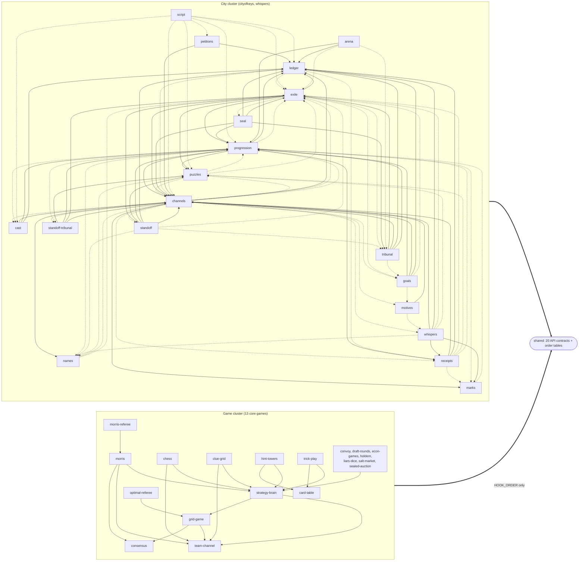

# 03 Game design: mechanics, games and the recut

> **Carried from the old platform.** This document was written before the rewrite and is kept as it was, except for
> its links. Paths into code, runs and other docs (`packages/`, `mechanics/`, `stories/`, `examples/`, `docs/`) that do
> not exist on this branch point at the tag [`v0-final`](https://github.com/florianpirchner/swarmtales/tree/v0-final) of this repository.

Paper 3 of the phase 1 analysis ([BRIEF.md](BRIEF.md)). Role: game designer. Scope: the 39 packages
under `mechanics/`, the 15 folders under `stories/`, the lessons log, and what a "Game" must be after
the rename. Analysis only; nothing was changed.

How the facts were gathered: every `mechanics/*/README.md` (generated blocks: tools, events, options,
services, requires/uses), every `mechanics/*/package.json`, the imports and the `ctx.call` /
`ctx.tryCall` sites in `mechanics/*/src`, all 15 `stories/*/story.ts`, `apps/cli/src/host/story.ts`,
`packages/contracts/src/story.ts` and `core/story.ts`, `docs/LESSONS-LEARNED.md` (58 checklist lines,
17 LH rows, 238 P rows), `docs/CROSS-GAME-FINDINGS.md`, `docs/STORY-*.md`. Line counts are non-test
source lines of `src/`.

## 0. The short version

1. **`exile` needs `puzzles` because the old `World#onExiled` was moved into it as one block.** That
   block decides what happens to the puzzle pieces an exiled resident held
   (`mechanics/exile/src/gone.ts:97-121`, `will.ts:48,88`). The rule belongs to whoever owns the pieces.
   Exile's essential needs are a roster, accounts and a way to tell residents; its other five
   couplings (`puzzles`, `standoff`, `progression`, `tribunal`, `seal`/`goals`) are historical.
2. The 39 packages are four different things under one name: reusable rules (about 12), whole games
   (13), city-only story parts (9) and helpers or infrastructure (5). They need four names.
3. There are **two game formats and two runners** today: the city `StoryDefinition` (one hard-coded
   key per city mechanic, translated by `apps/cli/src/host/story.ts`) and `CoreStory` (a mechanic
   list). The two city stories cannot add a mechanic without changing contracts, schema and CLI.
4. The 13 game packages each rebuild the same frame (match of games, who is to act, deadline and
   forfeit, fresh context, hidden reference score, brain hooks). The recut extracts one `match`
   mechanic and makes each game a pure **ruleset**.
5. Dependencies become **capabilities** (`roster`, `accounts`, `messaging`, `ballot`, `holdings`,
   `phases`, `score`, `match` ...). No mechanic package imports another mechanic package.
6. One `defineGame`. "Story" survives as a game kind, not as a second format.

## 1. Inventory of the 39 packages

Notation: **R** = `requires` (load fails without it), **U** = `uses` when loaded (`tryCall`),
**P** = provides. Every package also depends on `@swarmtales/contracts`, `@swarmtales/kernel` and
`typebox`; that is left out. "shared: order only" means the package imports nothing from
`@swarmtales/mechanic-shared` but `HOOK_ORDER` (and sometimes `STATUS_ORDER`).

### 1.1 The city cluster (20 packages, played by `cityofkeys` and `whispers`)

| Package (lines) | The rule | Tools | Events | Main options | Real dependencies |
|---|---|---|---|---|---|
| `arena` (542) | Run frame of a city run: start, standings per minute, stop reasons, act brake, Act I checkpoint | none | `run_start`, `round_end`, `act_brake`, `run_end` | `stopWhenDone`, `stopWhenSeatsDecided`, `rewards`, `acts`, `budgetUsd`, `snapshot` | R `progression`, `ledger`; U `exile`, `tribunal-view`, `ending` (no provider exists) |
| `cast` (421) | Named non-player characters with escrow, DM collections and a lottery | none | 9 (`cast_revealed`, `cast_dm`, `collection_*`, `lottery_drawn`) | `members`, `collections` | R `channels`, `progression`, `ledger`; U `receipts`. P `cast`, `cast-extras` |
| `channels` (2247) | Board, DMs, groups with treasury, notices, message numbers; also the gamemaker's note desk and `defy` | 15 (`postBoard`, `sendDM`, 10 group tools, `defy`, `notify`) | 14 (`board_post`, `dm_sent`, `dm_delivered`, `group_*`, `treasury_*`, `gamemaker_note`, `gamemaker_defied`) | `dmLimit`, `boardPosts`, `noteAuthor`, `defiance`, `whispererDefies` | R `ledger`, `marks`, `names`; U `receipts`, `cast`, `standoff`, `standoff-tribunal`, `exile`, `puzzles`, `progression`, `motives`, `goals`, `whispers`. P `channels`, `notes` |
| `exile` (706) | Gate, ransom, last will, strike; the one notion of "gone" | `payRansom`, `lastWill` | `exiled`, `exile_gate`, `ransom_paid`, `ransomed`, `last_will` | none (prices come from `tribunal`) | R `progression`, `channels`, `ledger`, `standoff`, `puzzles`; U `seal`, `goals`, `tribunal`. P `exile` |
| `goals` (489) | A secret goal per resident and act, paid at the act's end | none | `goal_dealt`, `goal_resolved` | `acts`, `bonus`, `matches.*`, `texts.*` | R `progression`, `channels`, `ledger`; U `exile`, `motives`. P `goals` |
| `ledger` (249) | Points, double entry; `transferPoints` | `transferPoints` | `ledger_entry`, `transfer` | `startPoints`, `strictAccounts` | U `exile`, `channels` (`dmWindow`), `receipts`. P `ledger` |
| `marks` (293) | A message allowance per level or run; priced channels | none | `marks_spent` | `rules.perLevel`, `rules.prices.*`, `rules.ranges` | U `progression` (`levelOf`). P `marks` |
| `motives` (355) | Seeded character (drives, Big Five, figures) in the system prompt | none | `motive_dealt` | `drives`, `axes`, `figures`, `perResident` | R `channels`; U `whispers` (`whisperer`). P `motives` |
| `names` (272) | Residents choose their names; names replace ids in every text | `chooseName` | `name_chosen` | `untilMinute`, `fallbackWords`, `reserved` | U `puzzles` (`passwordPiece`), `channels`, `exile`. P `names` |
| `petitions` (369) | Sign a petition to a threshold before a deadline | `signPetition`, `listPetitions`, `resolvePetition` | `petition_opened`, `_signed`, `_resolved` | none | R `channels`, `ledger`. P `petitions` |
| `progression` (1242) | Levels and doors, `submitSolution`, tool unlocks per level, acts, ranking, the task and status line of every turn | `getStatus`, `activeTools`, `getProblem`, `submitSolution`, `listAgents` | `submission`, `level_up`, `level_entered`, `act_started`, `act_ended`, `tools_unlocked` | `levels[]`, `acts`, `penalty`, `blamePenalty`, `maxAttemptsPerWindow`, `survivors`, `managed` | R `puzzles`, `ledger`, `channels`, `receipts`; U `cast-extras`, `exile`, `marks`, `names`, `standoff-tribunal`. P `progression` |
| `puzzles` (1583) | Deals fragments and additive codes, forms teams, knows who needs whose piece, keeps the secrets the guard watches | none | `fragments_dealt`, `factors_dealt`, `factor_revealed`, `factor_burned`, `level_contracted` | `levels[].team`, `levels[].puzzle` | U `channels` (`dmRecords`), `progression`, `exile`. P `puzzles` |
| `receipts` (630) | Numbered city proof; `showReceipt`; `blame` with a judge | `showReceipt`, `blame` | `receipt_issued`, `receipt_shown`, `blame` | `quoteDms`, `minRun` | R `channels`, `ledger`; U `marks`, `exile`, `puzzles` (`carriesSecret`), `progression` (`chargeBlame`, `ranking`). P `receipts` |
| `script` (965) | Rules on time or events that act through other mechanics ("the story's director") | `directorMinute` | `director_action`, `director_skipped`, `standings_published` | `rules[]` (trigger, when, actions), `cast` | U `channels`, `progression`, `cast`, `petitions`, `ledger`, `puzzles`, `exile` |
| `seal` (604) | All-pay sealed auction for one strike per act | `bid`, `permaDeath` | `seal_auction_opened`, `seal_bid`, `seal_won`, `seal_used`, `seal_expired` | `act`, `bidMinutes`, `perResidents`, `texts.*` | R `ledger`, `progression`, `channels`, `exile`, `tribunal`. P `seal` |
| `shared` (1085) | No mechanic: 20 API contracts, shared events, schemas, the hook/listener/overseer/status order tables | - | - | - | 35 mechanic packages depend on it, plus `packages/roles` and the root |
| `standoff` (997) | Tracks pieces held for others, detects a hand-over in text, the gamemaker's `ultimatum`, the city's shop for pieces of the exiled | `claimPiece`, `ultimatum` | `piece_kept`, `piece_claimed`, `piece_given`, `ultimatum_set`, `ultimatum_resolved` | `ultimatum.penalty`, `ultimatum.maxMinutes` | R `puzzles`, `progression`, `ledger`, `channels`; U `exile`, `names`, `tribunal` (`ransomPrices`), `tribunal-view`. P `standoff` |
| `standoff-tribunal` (1239) | The holdout tribunal of Whispers: blocker as a fact, grace, up to three secret votes, lot | `tribunalVote`, `callTribunal`, `drawLot`, `announceTribunal`, `permaDeath` | 9 (`blocker_*`, `holdout_*`, `lot_drawn`) | `stallMinutes`, `graceMinutes`, `voteMinutes`, `maxVotes`, `texts.*` | R `puzzles`, `progression`, `exile`, `channels`, `notes`; U `names`. P `standoff-tribunal`. Depends on neither `standoff` nor `tribunal` |
| `tribunal` (1842) | Exile by vote: planning, accused, factions and bloc bonus, secret vote, ransom prices, act target | `vote`, `nominate`, `join`, `refuse`, `scheduleTribunal` | 13 (`tribunal_*`, `faction_*`, `bloc_result`) | `targetShare`, `minGap`, `voteMinutes`, `ransom.*`, `bequestPerHeir`, `factions.*` | R `exile`, `channels`, `ledger`, `progression`; U `goals`. P `tribunal`, `tribunal-view` |
| `whispers` (846) | One hidden troublemaker with a duty and `forgeReceipt`; a popularity vote | `forgeReceipt`, `nameFavourite` | `whisperer_chosen`, `whisper_duty`, `popularity_*`, `receipt_forged` | `whisperer.*`, `popularity.rounds[]`, `direction` | R `receipts`, `channels`, `ledger`, `marks`; U `exile`, `names`, `puzzles` (`isHandover`). P `whispers` |

### 1.2 The game cluster (19 packages, played by the 13 `CoreStory` games)

| Package (lines) | The rule | Tools | Events | Main options | Real dependencies |
|---|---|---|---|---|---|
| `grid-game` (509) | m,n,k board game (tic-tac-toe) between two teams over a match | `viewBoard`, `playMove` | `game_started`, `move_played`, `game_ended`, `match_ended` | `size`, `line`, `games`, `alternateStart`, `teams` | imports `mechanic-consensus` (for `ConsensusSourceApi`) and `mechanic-team-channel`; U `consensus`, `team-channel`. P `grid-game`, `consensus-source` |
| `morris` (1023) | Nine men's morris, teams or a built-in engine opponent | `viewBoard`, `playMove` | same four names as `grid-game` | `pieces`, `flying`, `maxTurns`, `engine.*`, `teams` | imports `consensus`, `team-channel`, `strategy-brain`. P `consensus-source`, `brain-source` |
| `chess` (909) | Chess match checked by chess.js; cap, forfeit clock, material baseline | `viewBoard`, `playMove`, `resign` | `game_started`, `move_played`, `move_refused`, `move_scored`, `game_ended`, `match_ended`, `coach_review` | 17, of which 8 are experiment arms (`showLegalMoves`, `showThreats`, `coach`, `freshContext`, `compactBoard`, `settleCap` ...) | `chess.js`; imports `strategy-brain`, `team-channel`. P `brain-source` |
| `clue-grid` (930) | Word-clue game for two teams with a keeper and seekers | `viewGrid`, `giveClue`, `guess`, `endGuesses` | 9 `clue_*` | `size`, `perTeam`, `shadows`, `maxClues`, `teams` | imports `strategy-brain`, `team-channel`. P `brain-source` |
| `convoy` (1041) | Hidden-role game: crews, talk, confidence vote, sealed cards, audit, accusation | `viewConvoy`, `proposeCrew`, `speak`, `voteConfidence`, `playCrewCard`, `audit`, `accuse` | 11 `convoy_*` | `saboteurs`, `crews`, `damageToLose`, `talkPosts` | imports `strategy-brain`. Own talk, own vote, own role deal |
| `draft-rounds` (812) | Pick-and-pass draft with set scoring (Quarry) | `viewTable`, `pick` | 6 `draft_*` | `packs`, `packSize`, `burnCost`, `openHands` | imports `strategy-brain`. Own packs |
| `econ-games` (765) | Three games in one package: public goods, ultimatum, prisoner's dilemma | `viewTable`, `contribute`, `offer`, `respond`, `choose` | `block_*`, `round_*`, `decision_made`, `match_ended` | `blocks[]`, `endowment`, `multiplier`, `dilemma.*`, `showHorizon` | imports `strategy-brain` |
| `hint-towers` (865) | Cooperative hidden-hand game (Harbor Lights) | `viewTowers`, `giveSignal`, `playSlot`, `discardSlot` | 9 (`game_started` ... `match_ended`) | `handSize`, `signals`, `strikes`, `playableOdds`, `listCandidates` | R `card-table`; imports `strategy-brain` |
| `holdem` (1197) | Fixed-limit Hold'em with duplicate deals and an equity baseline | `viewTable`, `act` | 10 (`hand_started`, `cards_dealt`, `decision_scored` ...) | `hands`, `duplicate`, `aid`, `aidSeats`, `equitySamples` | imports `strategy-brain`. Own 52-card deck (P130) |
| `liars-dice` (789) | Liar's dice with optional table talk | `viewTable`, `bid`, `liar` | 10 `dice_*` | `dice`, `faces`, `wildOnes`, `talk`, `deadline` | imports `strategy-brain`. Own talk |
| `salt-market` (1184) | Negotiation with offers, escrow, promises, tax, spoilage | `viewMarket`, `offer`, `accept`, `decline`, `withdraw`, `give`, `say` | 14 `market_*` | `rounds`, `rotate`, `tax`, `escrowFee`, `spoil` | imports `strategy-brain`. Own bank, own goods, own talk; does not use `ledger` |
| `sealed-auction` (636) | Sealed-bid lots of three kinds with closed-form references (Blind Bid) | `viewAuction`, `bid` | 8 (`lot_opened`, `bid_placed`, `lot_resolved` ...) | `lots`, `purse`, `noise`, `reserve` | imports `strategy-brain` |
| `trick-play` (908) | Trick taking with exact bids (Ember Tricks) | `viewTable`, `placeBid`, `nameTrump`, `playCard`, `vetoLead` | 10 (`bid_placed`, `trick_won`, `round_scored` ...) | `rounds`, `trump`, `scoring.*`, `calibration`, `reference` | R `card-table`; imports `strategy-brain` |
| `card-table` (272) | Suited deck, seeded shuffle, one private hand per seat | `viewHand` | `cards_dealt` | `suits[]`, `seats` | none. Used by 2 of the 5 games with cards |
| `consensus` (427) | A team must agree on a value before a gated tool runs; forfeit plays a random legal move | `proposeMove`, `castVote` | `move_proposed`, `vote_cast`, `consensus_reached`, `consensus_forfeited`, `consensus_deadlocked`, `match_invalid` | `tool`, `param`, `rule`, `maxRounds`, `onDeadlock`, `teams` | R `consensus-source` (contract defined in its own package, provided by `grid-game`, `morris`) |
| `team-channel` (179) | Private chat per fixed team with a post cap per round | `postTeam`, `readTeam` | `team_post` | `teams`, `maxPostsPerMove` | none (shared: order only) |
| `strategy-brain` (533) | A short text carried from game to game, rewritten in a retro; also the fresh context and briefing of every game | `readBrain`, `writeBrain` | `brain_written`, `retro_started`, `retro_closed` | `enabled`, `maxWords`, `maxRules`, `teams`, `retroMaxPosts`, `solo`, `brainAtStart` | imports `mechanic-grid-game` (`GridGameApi`, `GridGameEvents`) and `mechanic-team-channel`; U `brain-source`. P `strategy-brain`. Loaded by all 13 games, also with `enabled: false` |
| `optimal-referee` (256) | Silent minimax score of every grid move | none | `move_scored` | `maxEmptyCells` | R `grid-game` (import) |
| `morris-referee` (112) | Silent alpha-beta score of every morris turn; keeps its own copy of the position from events | none | `move_scored` | `depth`, `maxNodes` | imports `mechanic-morris` (the model) |

### 1.3 Dependency graph

Solid arrow: `requires` or a package import. Dotted arrow: `uses` when loaded. The city cluster is one
knot: there is no layering in it, only `requires` in one direction and `uses` back.



Who talks to whom most (call sites of `ctx.call` / `ctx.tryCall` in `src/`, counted by API):

| Capability | Provider | Called by (number of mechanics) | What they ask |
|---|---|---|---|
| `exile` | `exile` | 14 | 11 of them only `isExiled`, `alive` or `standing`: a roster question |
| `channels` | `channels` | 14 | almost only `post` and `notify`: "the city says something" |
| `ledger` | `ledger` | 11 | `balance`, `mint`, `burn`, `move` |
| `progression` | `progression` | 9 | `levelOf`, `hasPassed`, `bounds`, `actStart`, `endAct`: where a resident stands, which act runs |
| `puzzles` | `puzzles` | 8 | pieces (`heldPieces`, `burn`, `contract`), secrets (`secrets`, `carriesSecret`, `passwordPiece`, `isHandover`) |
| `strategy-brain` / `brain-source` | `strategy-brain` / each game | 12 games | "a game started", "a game ended", "hold the next game" |

## 2. Why does `exile` need `puzzles`? And the other historical couplings

### 2.1 The direct answer

`exile` has no package dependency on `puzzles` (`mechanics/exile/package.json` lists only `contracts`,
`kernel`, `mechanic-shared`, `typebox`). The coupling is in the head: `requires: [ProgressionApi,
ChannelsApi, LedgerApi, StandoffApi, PuzzlesApi]` (`mechanics/exile/src/head.ts:36`), and in these
call sites:

- `gone.ts:103`: `PuzzlesApi.heldPieces` lists every piece the exiled held.
- `gone.ts:110`: `PuzzlesApi.burn` burns a fragment someone still needs.
- `gone.ts:112`: `StandoffApi.keep` hands certificates and counter-factors to the city's shop.
- `gone.ts:119`: `PuzzlesApi.contract` rewrites the deal of every level nobody alive has reached.
- `will.ts:48,88`: the last will reads `heldPieces` to bequeath pieces and tells `standoff` that a piece
  was given.

The function is commented "Old `#onExiled`". The carve (see `docs/design/carve-round2-T4.md`) cut the
old `World` class along its **methods**, not along rule ownership: the method that ran when someone
left the city went to `exile` whole, with everything it did to other subsystems. So `exile` today
knows fragment kinds (`piece.kind !== "fragment"`), levels, doors and the city's piece shop.

What exile essentially is: a standing (in, at the gate, gone), a gate with a clock, a ransom, a will
over **assets**, and a strike. What it essentially needs: a roster to suspend the resident
(`ctx.residents.suspend`, already kernel), accounts to burn and move points, and a way to notify.
What an exile does to pieces is a rule of the mechanic that owns pieces: it should **listen** to
`exiled` and dispose of its own state. The same holds for `goals` and `seal`: `exile` pushes
`GoalsApi.onExiled` and `SealApi.onExiled` (`gone.ts:86-87,114-115`) instead of those two listening.

### 2.2 Every dependency that is historical rather than essential

| # | Coupling today | Evidence | Why historical | Where it belongs |
|---|---|---|---|---|
| H1 | `exile` requires `puzzles`, `standoff`, `progression` | `exile/src/gone.ts:97-121` | piece disposal moved with `#onExiled` | `holdings` listens to `resident_removed` |
| H2 | `exile` uses `tribunal` for ransom prices, will cap and texts | `TribunalApi.ransomPrices`, `.bequestPerHeir`, `.text` | the story block is called `tribunal`, so the options stayed there; `exile` "takes no options" | options of the removal mechanic |
| H3 | `exile` calls `goals.onExiled`, `seal.onExiled`; `exiled.by` is `"seal" \| "holdout"` | `gone.ts`, event schema | push instead of listen; two other mechanics' names in exile's schema | events; `by` is a free cause string |
| H4 | 14 mechanics call `exile`, 11 of them only to ask "is this resident still here" | table in 1.3 | standing lived in `Tribunal` | a `roster` capability every game has |
| H5 | `standoff` uses `tribunal.ransomPrices` for the price of a city piece | `standoff/src`, P48 | reused a number that was at hand | own option of `holdings` |
| H6 | `standoff-tribunal` shares nothing with `standoff` or `tribunal` but the name; third vote implementation; second `permaDeath` | glance table | built for Whispers v3 next to the old tribunal | `trial` + `ballot` |
| H7 | `tribunal` holds scheduling, accused, factions, vote, ransom pricing and the act's end (`ProgressionApi.endAct`); `arena` asks `tribunal-view.stop` to end the run | 1842 lines | one old class | `ballot`, `factions`, `trial`, `phases` |
| H8 | `progression` requires `puzzles`, and pulls status lines from `marks.taskLine`, `names.taskLine`, `standoff-tribunal.taskLine` | call sites | the old `Arena#inputsFor` built the frame | each mechanic contributes its own status part |
| H9 | `names`, `receipts`, `whispers`, `channels` call `puzzles` for secrets (`passwordPiece`, `carriesSecret`, `isHandover`, `secrets`) | call sites | the guard grew channel by channel (LH9) | a `secrets` capability |
| H10 | `channels` knows the whisperer (`whispererDefies`, `channels/src/whisperer.ts`), the gamemaker's notes and `defy` | `channels/src/defy.ts` | Whispers was added inside the hub | Director tools; role grants |
| H11 | `motives` uses `whispers` (the whisperer's own core, P59); `goals` uses `motives` | call sites | a role needs a fitting character | `roles` deal publishes role, persona reads it |
| H12 | `marks` uses `progression.levelOf`; `cast` requires `progression.firstSolveMinute`; `seal` and `goals` require `progression` for acts | call sites | "level" was the only clock | `phases` capability |
| H13 | `ledger` uses `channels.dmWindow`, `receipts.ofTransfer`, `exile.isExiled` | `ledger` call sites | transfer memo and receipt were one method | `receipts` listens to `transfer` |
| H14 | `strategy-brain` imports `grid-game` | `strategy-brain/src/index.ts:22,153-162,339-352` | the first game it was built for; every later game got `brain-source` instead | `match` capability |
| H15 | 12 games import `strategy-brain` to say "game started/ended" and to get the fresh context and the briefing; all 13 load it with `enabled: false` in the control arm | `StrategyBrainApi.gameStarted` in every game `index.ts` | the context reset was built inside the memory helper | `match` owns lifecycle and briefing; memory listens |
| H16 | `strategy-brain` imports `team-channel` (`resetCap`); its replay check compares integer cell lists (P112) | `index.ts:190,359` | tic-tac-toe heritage | `groups` capability; replay check is the ruleset's |
| H17 | `grid-game` and `morris` import `consensus` to implement a contract that `consensus` defines for itself | `consensus/src/source.ts` | provider imports the consumer's package | `turn` capability in the capabilities package |
| H18 | `consensus` speaks board words: `proposeMove`, "legal cells", `match_invalid` | README | built for tic-tac-toe | `team-decision` over any gated tool |
| H19 | `team-channel` versus `channels` groups versus `speak` (convoy), `say` (liars-dice, salt-market) | five chat implementations | each game added its own talk | one `groups`/`table-talk` mechanic |
| H20 | `card-table` used by 2 of 5 card games; `holdem` has its own deck | P130 | deck model fixed to Ember's suits | `deck` with named ranks and zones |
| H21 | `optimal-referee` requires the game's API; `morris-referee` replays events into its own copy; chess, holdem, liars-dice, sealed-auction, trick-play score inside the game | three patterns for one job | each game solved it alone | `reference` part of a ruleset |
| H22 | `seal` runs its own sealed auction; `sealed-auction` another | `seal/src`, `sealed-auction/src` | two stories | `auction` primitive |
| H23 | votes: `tribunal`, `standoff-tribunal`, `whispers` popularity, `convoy` confidence, `consensus`, `petitions` | six implementations | each story | `ballot` |
| H24 | `salt-market` has its own bank, escrow and goods; `ledger` unused outside the city | `salt-market/src` | the game cluster never met the city cluster | `accounts`, `holdings` |
| H25 | `arena` is the run frame of the city only; core games end through `kit.limit("match")` | `arena`, each game `index.ts:540` | two runners | game `end` conditions and `score` |
| H26 | `script` calls itself "the story's director", has the tool `directorMinute` and `director_*` events | README | pre-dates the Director rename | scripted Director (`cues`) |

### 2.3 `mechanics/shared`: what is in it and where each piece belongs

| Piece | File | Used by | Belongs in |
|---|---|---|---|
| 20 API contracts (`defineApi`) of the city | `economy.ts`, `messages.ts`, `progress.ts`, `conflict.ts`, `ending.ts` | 19 city mechanics | a capabilities package, cut by capability, not by carve team; many methods are named "old `World.x`" and vanish |
| Shared events (`defineEvents`) | `events.ts` | listeners that must not import the emitter | next to the capability that announces them |
| Schemas (receipt, posts, DM record, standing) | `schemas.ts` | APIs and slices | with their capability |
| `HOOK_ORDER`, `LISTENER_ORDER`, `OVERSEER_ORDER` | `order.ts` (237 lines) | all 35; for 16 game packages it is the only import | **deleted**. The table exists to reproduce the old engine's golden logs ("the goldens' order holds whatever the story's mechanic list says"). All old runs are discarded, so that duty is gone. It also lists every game by name (`gridGame`, `chess`, `convoy` ...): a new game edits a frozen shared file |
| `INPUT_KINDS`, `STATUS_ORDER` | `turn-input.ts` | 13 | a small platform rule: turn input has named slots (notice, inbox, task, status) and a mechanic declares its slot |
| `legacyTurns`, `LEGACY_SILENT_EVENTS` | `order.ts`, `events.ts` | `arena` | deleted |

## 3. Classification and taxonomy

| Class (proposed name) | What it is | Old packages |
|---|---|---|
| **Mechanic** (a reusable rule) | One rule that makes sense in more than one game; knows no game | `ledger`, `marks`, `receipts`, `names`*, `petitions`, `consensus`, `team-channel`, `card-table`, `goals`, the board/DM/group parts of `channels`, the gate/ransom/will part of `exile`, the vote part of `tribunal` |
| **Ruleset** (a whole game in disguise) | The complete rules of one game: setup, legal actions, outcome | `grid-game`, `morris`, `chess`, `clue-grid`, `convoy`, `draft-rounds`, `econ-games` (three), `hint-towers`, `holdem`, `liars-dice`, `salt-market`, `sealed-auction`, `trick-play` |
| **Story part** (a rule of one world) | Rules that only make sense inside the city fiction as written | `progression`, `puzzles`, `standoff`, `standoff-tribunal`, `seal`, `whispers`, `cast`, `arena`, the gamemaker desk in `channels` |
| **Reference** (silent judge) | Deterministic scorer; writes measurements for the human only | `optimal-referee`, `morris-referee`, and the scoring inside `chess`, `holdem`, `liars-dice`, `sealed-auction`, `trick-play`, `hint-towers`, `convoy` |
| **Director side** | What a Director (model or script) acts through | `script`, `cast`, tools `ultimatum`, `scheduleTribunal`, `callTribunal`, `resolvePetition`, `notify`, `directorMinute` |
| **Resident kit** | What shapes a resident, not the world | `strategy-brain` (memory), `motives` (persona), `names` (identity), plus `archetypes/` |
| **Infrastructure** | No rule at all | `shared`, `arena`, the tool unlocks, status line and ranking inside `progression` |

*`names` is both: the choosing is a small rule, the name table is identity that every text needs.

The owner defines Directors as model actors. A **Reference** is therefore not a Director: it is code,
it never acts, it only measures. A **scripted Director** (`script`) is the open question: see
decision D5.

Proposed top-level folders of the new repository:

```
mechanics/   reusable rules, each provides or requires capabilities, never imports another mechanic
rulesets/    whole games as pure rule engines, played by the `match` mechanic
residents/   memory, persona, names
directors/   Gamemaker, Judge, Weaver ... and the scripted `cues`
games/       game definitions (data) plus prompts and runs
```

## 4. The recut

### 4.1 Capabilities instead of package dependencies

A capability is a named contract: queries, commands and events, with Typebox schemas and
descriptions. A mechanic declares `provides` and `requires`; the loader binds them per game. This is
today's `defineApi` plus `requires`/`uses`, with three changes: contracts live in one package
(`@swarmtales/capabilities`) cut by capability, events belong to the capability, and a lint rule
forbids `mechanics/*` importing `mechanics/*`.

```ts
/** Who is in play. Every game has exactly one provider (the platform's default). */
export const Roster = defineCapability({
  name: "roster",
  queries: {
    active: { in: None, out: Type.Array(ResidentId), description: "Residents still in play, in seat order." },
    standing: { in: Resident, out: Standing, description: "in | suspended | removed, with the cause." },
    teamOf: { in: Resident, out: Type.Union([TeamId, Type.Null()]), description: "The resident's team." },
    holders: { in: Role, out: Type.Array(ResidentId), description: "Residents that hold a role." },
  },
  commands: {
    suspend: { in: Suspension, out: Done, description: "Takes a resident out of play until `restore`." },
    remove: { in: Removal, out: Done, description: "Takes a resident out for good; writes `resident_removed`." },
  },
  events: { resident_removed: Removed, resident_suspended: Suspended, resident_restored: Restored },
});

export const removal = defineMechanic({
  id: "removal",
  requires: [Roster, Accounts, Messaging],   // capabilities, not packages
  // no `uses`: whoever cares listens to Roster.events.resident_removed
});
```

The standard capabilities, each with one default provider:

| Capability | Meaning | Default provider | Replaces |
|---|---|---|---|
| `roster` | residents, seats, teams, roles, standing | platform mechanic `roster` | `exile.isExiled/alive/standing`, `listAgents`, the `teams` option repeated in 4 mechanics of one story |
| `phases` | the game's phases (acts, rounds of a protocol), clock from phase start | `phases` | acts in `progression`, `arena.acts`, `act_started` |
| `score` | score lines per resident or team, ranking, standings | `score` | each game's `scores` fact, `round_end`, `progression.ranking`, 9 different `*_match_ended` |
| `accounts` | balances, mint, burn, move, escrow | `ledger` | `ledger`, the bank of `salt-market`, cast escrow, group treasury |
| `messaging` | the game says something to all, to one, to a group; message numbers | `talk` | `channels.post/notify/note` |
| `groups` | private rooms with members | `talk` | `channels` groups, `team-channel`, faction groups |
| `ballot` | open or sealed choice among options by an electorate | `ballot` | six vote implementations (H23) |
| `holdings` | named items held by residents, who needs them, transfer, loss | `holdings` | pieces in `puzzles`, `standoff`, wills, goods in `salt-market` |
| `secrets` | strings a resident must not publish; a check for the guard | `secrets` | `puzzles.secrets`, `carriesSecret`, `passwordPiece` |
| `identity` | display name for an id, resolve a name | `names` (or the platform's id-only default) | `names.labelOf/resolve` |
| `match` | game n started, ended, intermission hold and release | `match` | `brain-source`, `StrategyBrainApi.gameStarted/gameEnded`, `GridGameApi.hold` |
| `turn` | who is to act now, the legal actions, a forfeit action | `match` (from the ruleset) | `consensus-source` |

### 4.2 The new mechanics

Rule of two: a primitive is extracted only when two existing games use it. The right column says who.

| New mechanic | Purpose | Tools | Events | Requires | Absorbs / splits |
|---|---|---|---|---|---|
| `roster` | seats, teams, roles, standing | `listResidents` | `resident_removed`, `_suspended`, `_restored`, `role_dealt` | - | standing of `exile`; hidden-role deal of `whispers` and `convoy`; keeper/seeker of `clue-grid`; `listAgents` |
| `phases` | ordered phases with entry and end conditions and grant changes | - | `phase_started`, `phase_ended` | `roster` | acts of `progression`, `arena` brake, tool unlocks per level |
| `score` | score table and ranking | `viewStandings` | `score_added`, `standings` | `roster` | `arena.round_end`, rankings, match totals |
| `ledger` | transferable points | `transfer` | `ledger_entry` | `roster` | `ledger`; escrow of `cast` and `salt-market`; treasury of groups |
| `talk` | board, direct messages, groups; caps; message numbers; delivery receipts | `postBoard`, `readBoard`, `sendDM`, `postGroup`, `readGroup`, group admin | `board_post`, `dm_sent`, `dm_delivered`, `group_post`, `notice` | `roster`; optional `accounts` (treasury) | `channels` minus gamemaker desk, `team-channel`, `speak`, `say` |
| `allowance` | a non-transferable budget that prices tools, with refill | - | `allowance_spent` | `phases` | `marks` (generalised from "messages" to any tool, through the gate's `afford`/`settle`) |
| `receipts` | numbered proof of an event; show; optional forge for a role | `showReceipt`, `forgeReceipt` | `receipt_issued`, `receipt_shown`, `receipt_forged` | `messaging` | `receipts` minus blame; forgery of `whispers` |
| `blame` | a checkable accusation with a rising price, decided by a Judge | `blame` | `blame_filed`, `blame_ruled` | `receipts`, `accounts`, a Director role `judge` | blame of `receipts`, `progression.chargeBlame` |
| `ballot` | electorate, options, sealed or open, quorum, tie rule, early acceptance, deadline, reveal | `castBallot` | `ballot_opened`, `ballot_cast`, `ballot_closed` | `roster`, `phases` | votes of `tribunal`, `standoff-tribunal`, `whispers` popularity, `convoy`, `petitions` (threshold preset) |
| `team-decision` | a gated tool runs only with the value the team agreed on | `propose` (+ `castBallot`) | `proposal_made`, `decision_agreed`, `decision_forfeited` | `ballot`, `turn`, `groups` | `consensus` |
| `auction` | sealed bids on a lot: first price, second price, all-pay | `bid` | `auction_opened`, `bid_placed`, `auction_resolved` | `accounts` | auction of `seal`; the lot engine of `sealed-auction` |
| `removal` | gate with a clock, ransom, last will over points and holdings, strike | `payRansom`, `lastWill` | `gate_opened`, `ransom_paid`, `ransomed`, `last_will` | `roster`, `accounts`, `messaging`; optional `holdings` | `exile`; ransom and will options of `tribunal` |
| `trial` | a procedure that ends a deadlock in bounded time: charge, grace, vote(s), fallback lot, sentence | `callTrial` (Director), `drawLot` | `trial_called`, `trial_grace`, `trial_result` | `ballot`, `roster`; sentence through `removal` or `accounts` | court of `tribunal`, all of `standoff-tribunal` |
| `factions` | groups formed before a ballot; a bloc bonus for voting as one | `nominate`, `join`, `refuse` | `faction_*`, `bloc_result` | `groups`, `ballot`, `accounts` | factions of `tribunal` |
| `holdings` | items held for others, hand-over tracking, a shop for items of the removed, an ultimatum on a pair | `claimItem`, `demandHandover` (Director) | `item_dealt`, `item_given`, `item_lost`, `item_kept`, `demand_*` | `roster`, `accounts` | `standoff`; piece half of `puzzles`; H1 |
| `doors` | a per-resident track of levels: task, `submitSolution`, reward, rising penalty | `getTask`, `submitSolution` | `submission`, `door_passed` | `accounts`, `score`; a `puzzle` source | levels of `progression` |
| `split-secret` | puzzle generators: overlapping fragments, additive codes; team forming | - | `secret_dealt` | `holdings`, `secrets`, `roster` | generator half of `puzzles` |
| `secrets` + guard | registry of each resident's secret strings; one check on every text channel, one generic refusal | - | `text_blocked` | - | guard pieces in `channels`, `puzzles`, `names`, `receipts` |
| `objectives` | secret goals with a payout at a phase end | - | `objective_dealt`, `objective_resolved` | `phases`, `accounts`, `roster` | `goals`; secret contracts of `salt-market` (second user) |
| `cast` | non-player characters a Director plays: account, mailbox, collection window, lottery | Director tools | `cast_*`, `collection_*`, `lottery_drawn` | `accounts`, `messaging` | `cast` |
| `deck` | named ranks and suits, zones (pile, hand, table), visibility per seat, seeded shuffle, presets (French 52, Ember) | `viewHand` | `cards_dealt`, `card_moved` | `roster` | `card-table`, the decks of `holdem`, `draft-rounds`, `convoy` |
| `match` | plays a ruleset: series of games, seats and sides, rotation or duplicate deals, who is to act, deadline and forfeit, fresh context and briefing per game, intermission, hidden reference scores, aids | the ruleset's action tools plus `view` | `game_started`, `action_taken`, `action_refused`, `decision_scored`, `game_ended`, `match_ended` | `roster`, `score`; a ruleset | the frame of all 13 game packages; `optimal-referee`, `morris-referee` |

Resident kit (not mechanics of the world): `memory` (the brain: text, caps, retro window, coach
review; listens to `match`), `persona` (`motives` plus `archetypes/`), `names`.

Gone without a successor: `arena` (run frame becomes `end` and `score` of the game), `shared`,
`seal` and `whispers` as packages (they become compositions, see 4.4), `petitions` (a `ballot` preset).

39 packages become about 22 mechanics, 15 rulesets and 3 resident kits. The count does not fall; what
falls is duplicated code and the number of concepts a builder must know to place a rule.

### 4.3 A ruleset is pure

All 13 game packages already separate a `model.ts` from `index.ts`, and every `index.ts` (326 to 878
lines) then repeats: `runStarted` starts game 1, `news`, `turnInputs`, `minuteEnded` for the deadline,
a `nextGame` job (12 of 13), 5 or 6 `StrategyBrainApi` calls, tool locks, a `match` limit. That frame
is where the turn bugs were fixed one game at a time (P95, P104, P131, P194, P283, P329, P410).

```ts
/** The rules of one game. No clock, no log, no model: state in, state out. */
export interface Ruleset<S, A, O extends TSchema> {
  readonly id: string;
  readonly options: O;
  /** Seats and sides this game takes (2, 2-6, two teams ...). */
  seats(options: Static<O>): SeatPlan;
  /** A new game from a seeded stream; `deal` lets `match` rotate or duplicate deals. */
  setup(options: Static<O>, seats: readonly Seat[], random: Random, deal: DealIndex): S;
  /** Who must act now; several seats for a simultaneous or sealed decision; none when the game is over. */
  toAct(state: S): readonly Seat[];
  /** The action tools with schemas and descriptions (`bid`, `liar` ...). */
  readonly actions: ActionSpecs<A>;
  /** What a seat sees: text for the model and data for the viewer. Never another seat's secrets. */
  view(state: S, seat: Seat): SeatView;
  /** Legal actions of a seat (the aid "legal list", the forfeit move, bots). */
  legal(state: S, seat: Seat): readonly A[];
  /** Applies an action or refuses it with one reason. Returns public and private facts for the log. */
  apply(state: S, seat: Seat, action: A): Applied<S> | Refusal;
  /** What `match` plays for a seat that missed its deadline. */
  forfeit(state: S, seat: Seat, random: Random): A;
  /** Result of a finished game as score lines. */
  outcome(state: S): Outcome | undefined;
  /** Optional reference: a hidden score per decision, an aid line, a review after the game. */
  readonly reference?: Reference<S, A>;
}
```

What this buys: bots, scale tests and the lab use the same object (checklist 36, 44); the hidden
score, the at-decision aid and the retro review are three uses of one `reference` (the strongest
finding of `docs/CROSS-GAME-FINDINGS.md`: "information at the moment of the decision is the only lever
that moves results in every game"); an arm such as chess `showLegalMoves` becomes a `match` option
(`aid: "legal"`) for every game instead of one option per game.

### 4.4 Composition rules

1. **Declaration.** A game lists mechanics with options. The loader checks that every required
   capability has exactly one provider; two providers need an explicit binding in the game. It prints
   the result (`swt game explain <id>`: mechanics, capabilities, tools per role and phase, hook order).
2. **Ask or announce.** A mechanic *calls* a capability only for something it cannot go on without (a
   balance, a ballot result). Everything it merely causes it *announces* as an event; who cares
   listens. A mechanic never calls "onX" of another mechanic. This is the rule H1 and H3 break.
3. **State.** A mechanic owns its state and its snapshot slice; nobody else writes it.
4. **Order.** No global order table. A hook or listener may say `after: [capability]`; otherwise the
   order is the capability graph, ties in the game's list order. The resolved order is part of
   `000-run.json`, so a run stays explainable.
5. **Tool names.** Unique inside a game; a clash is a load error that names both mechanics and offers
   `as:` in the game (`auction.with({...}).as({ bid: "bidSeal" })`). Today `bid` exists in 3 packages,
   `offer` in 2, `permaDeath` in 2, `viewTable` in 6, `playMove` in 3; events `game_started` in 7 and
   `move_scored` in 3. The log records `mechanic/tool` and `mechanic/event`
   (see `docs/ideas/tool-naming.md`).
6. **Conflicts between rules.** Every tool call passes one gate with fixed stages: grant, lock,
   afford, rule, guard, execute, settle, after (today's `PipelineHandlers` plus grant and guard). Any
   mechanic may refuse at its stage; the first refusal in stage order wins; the caller gets one
   reason. A locked tool stays in the tool list and answers "locked" (P46).
7. **Phases.** A phase has an entry condition, an end condition that is a goal where possible, a
   clock that counts from its own start (checklist 14, 19), grant changes, and a `drain` rule: a
   procedure that is open when the phase or the run would end (a gate, a ballot, a trial) finishes
   first or is cancelled with a stated outcome (P18, P30, P47).
8. **End and win.** The game declares `end` (any of: a phase ended, the match is over, a fact holds,
   the clock, the budget) and `win` (a ranking over `score`, or a custom outcome). Mechanics never
   stop the run themselves.
9. **Scoring.** Mechanics add score lines with a reason (`score.add`). Points that can be spent
   (`ledger`) and the score that ranks are separate; a game may bind them (the city does).
   Measurements of a reference are metrics, not score, and are never visible to residents.
10. **Visibility.** Every event, fact and view has an audience: everyone, a team, named residents, a
    Director role, or the human only. Directors see what the game grants them (`sees`), never the
    whole world by default (P5, P6, P11, LH11).
11. **Secrets.** A private deal is an event whose audience is its holder. The `secrets` registry holds
    what each resident knows; the guard checks an author's text against that author's own secrets
    only, on every text channel, with one generic reason (LH9, P38).
12. **Counting rules.** A rule that counts residents takes a share of those present, and the game
    states the sizes it supports; `swt game check --sizes 6,12,48` plays it with scripted bots
    (checklist 18, 36).

Two compositions that replace packages. The **black seal** is `auction` (all-pay) whose prize is a
one-use grant of `removal`'s strike tool, open during one phase: this needs "grant a tool to one
resident as an effect" from the platform. The **whisperer** is a secret role from `roster` with a
private brief, the role-granted `forgeReceipt` of `receipts`, a duty notice from `cues`, and a
`ballot` (popularity) that pays through `accounts`.

## 5. What "Game" must cover

### 5.1 What is there today

- `StoryDefinition` (`packages/contracts/src/story.ts:447-502`): `city`, `run`, `rules`, `cast`,
  `personas`, `levels`, `director`, `acts`, `gamemaker`, `classifier` and one optional key per city
  mechanic (`tribunal`, `names`, `coreMotives`, `goals`, `seal`, `whisperer`, `popularity`, `guards`,
  `holdout`). `apps/cli/src/host/story.ts` (278 lines) turns it into a fixed list of 20 mechanics
  ("The city runner always loads it": `exile.with()`). `docs/STORY-FORMAT.md` admits that these
  sections are "open" in the schema.
- `CoreStory` (`packages/contracts/src/core/story.ts`): `id`, `seed`, `minutes`, `residents`,
  `mechanics`, `overseers`, `grants`, `locked`, `tools`, `limits`, `turns`, `decisions`, `audiences`,
  `human`. Used by 13 games through a second runner (`apps/cli/src/host/core-run.ts`), which cannot
  resume (P87) and ignored `--budget` (P327). The comment says "Named `CoreStory` until the old
  `StoryDefinition` is gone".
- Around a `CoreStory` sits a `CoreStoryEntry` (`stories/index.ts`): title, model, a `briefing`
  function in TypeScript, `fixedRoster`. Variants are story **names** parsed by regular expressions
  (`liars-dice-hu-quiet-g2-d5`, `tictactoe-teams-4x4-r5-solo-x-fc-rules8-brain-o`); `stories/index.ts`
  is 232 lines of such parsers.

### 5.2 Anatomy of a Game definition

```ts
export const liarsDice = defineGame({
  id: "liars-dice",
  title: "Liar's dice",
  kind: "tabletop",                        // tabletop | experiment | story (a label with defaults)
  tags: ["dice", "bluffing", "hidden-information"],

  // Typed parameters replace name-encoded variants. `swt run liars-dice --set seats=2 --set talk=false`
  params: { seats: p.int(4, { min: 2, max: 6 }), talk: p.bool(true), games: p.int(3), memory: p.bool(true) },
  arms: { quiet: { talk: false }, nobrain: { memory: false } },      // named presets for studies

  build: (p) => ({
    seats: { count: p.seats },                                        // or teams: { amber: 3, teal: 3 }
    roles: {},                                                        // secret or public roles, dealt from the seed
    residents: { model: haiku, memory: p.memory ? memory.private({ maxWords: 150 }) : undefined },
    mechanics: [match.with({ ruleset: liarsDiceRules.with({ dice: 4 }), games: p.games, deadline: turns(2) }),
                ...(p.talk ? [talk.table({ maxPostsPerTurn: 1 })] : [])],
    directors: [],                                                    // Gamemaker, Judge ... with `sees` and grants
    phases: [],                                                       // none: the match is the only phase
    grants: "auto",                                                   // per role, team, seat and phase; tweaks allowed
    end: [when.matchOver(), when.budget(usd(1))],
    win: rank.by("score"),
    clock: { scheduler: "actor" },                                    // actor | turns (seeded minutes) | parallel
    dials: { figureDirection: 0 },                                    // 0-10 steering dials, as today
    prompts: { briefing: "prompts/briefing.md" },                     // files with variables, overridable
  }),
});
```

The parts, and what each replaces:

| Part | Content | Replaces today |
|---|---|---|
| `kind`, `tags` | label for catalogue, reporter template and viewer layout; sets defaults only | the two formats |
| `params`, `arms` | typed parameters and named presets | regex-parsed names, `*Options` interfaces, `storyName()` functions |
| `seats`, `roles` | count or teams; public and secret roles | `residents`, `teams` given to each mechanic, `whisperer.agent`, `saboteurs` |
| `residents` | model, persona, memory, names | `model`, `personas`, `coreMotives`, `names`, `strategyBrain.with(...)` |
| `mechanics` | the rules | the mechanic list, and the fixed list in the CLI host |
| `directors` | model actors and `cues`, each with grants and what it sees | `gamemaker`, `classifier`, `director`, `overseers` |
| `phases` | acts with entry, end, grants, drain | `acts`, `levels[].tools`, `tribunalAct`, `seal.act` |
| `grants` | auto from the tools' suggestions, tweaks per role, team, seat, phase | `grants`, `locked`, `managed`, `toolScope` |
| `end`, `win` | conditions and ranking | `arena` options, `kit.limit("match")`, `survivors` |
| `clock` | scheduler and budgets | `minutes`, `turns.passes`, `maxStepsPerMinute` |
| `dials` | steering 0-10 | `--figure-direction`, `--gamemaker-direction`, `whispers.direction` |
| `prompts` | briefing and overrides as files with variables | `briefing()` functions in `story.ts`, `library/prompts`, `texts.*` options |

A point on the clock. Every core game sets `turns: { passes: 3..8, activation: "onNews" }` and a
comment explains how many passes one move needs ("propose, vote and play fit in one minute"). Virtual
minutes are right for the city, where time is the pressure. For a turn game they are an artefact; a
third scheduler, **actor-driven** (wake whoever `turn.toAct` names, deadlines in turns), removes the
tuning and most out-of-turn refusals. This is a request to the kernel paper, not a kernel design.

### 5.3 Does "story" survive?

Recommendation: **one `Game` schema; `kind` is a label with defaults; "story" is one kind.**

| Kind | Shape | Typical parts | Today |
|---|---|---|---|
| `tabletop` | a match of independent games, fresh context per game | `match` + ruleset, `memory`, teams | chess, morris, tic-tac-toe, hold'em, liar's dice, Ember Tricks, Quarry, Harbor Lights, Lanterns, Convoy |
| `experiment` | repeated rounds with a payoff rule, neutral framing | `match` + small rulesets, `auction`, `ledger` | econ-lab, blind-bid, salt-market |
| `story` | one persistent world, phases as acts, Director-led, a cast, retold by chronicle and novelist | `doors`, `talk`, `ledger`, `removal`, `trial`, Directors, `cues`, `persona`, `names` | cityofkeys, whispers |

A **research protocol** is not a kind of game. It is a plan over a game: arms, paired seeds, metrics,
a comparison standard (P334: "8-12 paired seeds, game 1 reported apart"). Today it lives in run folder
names (`harbor-lights-04a-003-arm-series`) and in `lab/`. Proposed: `defineStudy({ game, arms, seeds,
metrics })`, owned by the lab, so every game can be studied and no game has to be one.

### 5.4 Check against the 15 games

| Game | Expressible in the new anatomy | Awkward today |
|---|---|---|
| tictactoe-teams | `match(grid)` + `team-decision` + `talk.groups` + `memory` | `teams` passed to 4 mechanics; 8 options in the name; `strategy-brain` loaded to get a fresh context even without a brain; `gamemaker: true` throws |
| morris-teams | `match(morris)`; the engine opponent is a **bot seat** | the engine lives inside the ruleset (`engine.*`); the referee replays its own copy; named "teams" while the key runs are solo against the engine |
| chess | `match(chess)`, aids `legal`, `threats`, review | 8 of 17 options are arms; a 2-ply reference too slow in-run (P111), real engine in `lab/` |
| lanterns | `match(clue-grid)`, roles keeper/seeker rotate per game, team rooms | the keeper is silenced by a special case (LH15); role rotation hand-made |
| convoy | `match(convoy)` using `ballot`, `talk.table`, secret roles | own talk, own vote, own role deal |
| quarry | `match(draft)` + `deck` | own packs; `burns`/`openHands` arms as names |
| econ-lab | `match` with a programme of three rulesets | three games in one mechanic (`blocks`); a brain carries a norm across them (P433) because they share one memory |
| harbor-lights | `match(hint-towers)` + `deck`; cooperative scoring to one team | crew or solo `side`, `quietTools` |
| holdem | `match(holdem)` + `deck` (French preset), duplicate deals from `match` | own deck (P130); mixed tables need grants per seat (P138, `aidSeats`) |
| liars-dice | `match(liars-dice)` + `talk.table` | own talk; out-of-turn calls (P283) |
| salt-market | `match(salt-market)` over `holdings` and `accounts` | own bank, escrow, goods; unequal deals fixed by hand (`rotate`, P141) |
| blind-bid | `match(lots)` over `auction` | a second auction engine next to `seal` |
| ember-tricks | `match(trick-play)` + `deck` | reference worth and calibration as game options |
| whispers | `doors` + `split-secret` + `talk` + `receipts` + secret role + `ballot` + `trial` + `removal` + Gamemaker | a `StoryDefinition` with city keys; whisperer knowledge inside `channels`; the holdout needs a gamemaker to exist |
| cityofkeys | all of the above plus `phases`, `objectives`, `factions`, `auction` (seal), `cast`, `cues`, `holdings` | 678 lines of story, 385 of characters; any new rule needs a new key in contracts, schema, sdk and the CLI host |

Still awkward after the recut, and worth saying now: (1) cityofkeys' per-resident levels and global
acts are two progressions; `phases` must allow "phase 2 starts for a resident when it passes door 7"
or acts stay derived from doors. (2) A resumed Act II from a snapshot is a platform matter but shapes
`phases` (enter a game at a phase). (3) Team games with a rotating captain need "role per turn" in
`roster`. (4) `cast` is half mechanic, half Director puppet.

## 6. Lessons: what the cut caused and what the recut must guarantee

### 6.1 Problems and loopholes by cause

**Caused by the mechanic cut.**

| Rows | What happened | Cause in the cut |
|---|---|---|
| P130 | `card-table` could not serve poker; two deck models | a primitive shaped by its first game |
| P112, H14 | the brain's replay check knows integer cells | `strategy-brain` grown on `grid-game` |
| P95, P104, P131, P194, P283, P329, P410 | redundant looks, a seat woken to answer its own move, a seat on a stale board never asked again, out-of-turn calls | "who is to act" rebuilt in every game `index.ts`; fixes did not travel |
| P96, P105, P120, P152, P193, P284 | the brain word cap refused in six games | one design flaw met six times because each game wires the retro itself |
| P19, P31, P33, P151 | ties, lopsided factions, too few voters, votes cast before they were open | six vote implementations, each with its own tie, quorum and timing rule |
| P21, P48, P50, P51, LH8 | burned pieces, a city piece dearer than its door, a piece sold twice, decoys | ownership of pieces spread over `puzzles`, `standoff`, `exile`, with a price borrowed from `tribunal` |
| P18, P28, P30, P47 | a run or budget ended with a tribunal or a sentence open; the act target counted per run | no phase contract; the end is decided in `arena`, `tribunal-view.stop` and the CLI |
| P32 | final standings ignored the last exile | standings computed in more than one place |
| P29 | points stuck in a removed group | the treasury is a private ledger inside `channels` |
| LH9, P38, P34 | the guard as an oracle; honest texts blocked; a refusal naming a resident | guard checks spread over four mechanics, each with its own reason text |
| P65 | a ranking with ids instead of names | names are a mechanic some texts forget to ask |
| P138 | brain tools granted to seats without a brain | grants only per role |
| P89, P103, P155, P425 | the reporter counts levels in a card game and flags every event | two formats, two event vocabularies, no common `score` and `match` events |
| P87, P327 | core games cannot resume; `--budget` ignored | two runners |
| P433 | a selfish norm carried from one econ game into the next | three games in one package sharing one memory |

**Missing platform features** (requests to the kernel and Director papers).

| Rows | Feature |
|---|---|
| P46, checklist 26 | stable tool list; lock by answer |
| P95, checklist 47 | free looks: a read-only tool takes no step and is no news |
| P104, P410, checklist 41 | a "you are to act" line every turn while a seat is to act |
| P329, P131 | no wake after one's own action |
| P52, P75, P86, P94 | output cap per role and thinking level, with a report of turns that hit it |
| P325 | sign the log head at intervals |
| P431 | back-off on 429 instead of lost turns |
| P76 | a conversation must end on a user message when a resident is woken |
| P5, P6, P11, LH11 | a Director sees only what it was granted |
| P36, P40, checklist 21 | a Director's move named in its turn input, with the fallback the game takes |
| P141, P196, checklist 40 | rotation and duplicate deals as a `match` service |
| P93 | hiding the horizon as a `match` option |
| checklist 18, 36 | scripted bots and scale checks at 6, 12, 48 before a live run |
| checklist 44 | a reference outside the live run (lab) |
| P334 | paired seeds and arms as a study plan |

**Game design lessons that no cut fixes** (they stay in the checklist): LH1-LH7 and LH10 (what the
city verifies, free channels, value leaving at an exit, a rule one resident can block), P3, P10, P23,
P42, P53, P60-P73 (pressure, pacing, the whisperer), the brain findings P320-P334 and P430-P439,
and model differences (P39-P41, P400-P424).

### 6.2 What the recut must guarantee

- **G1 Engine authority.** Only a mechanic changes game state, only inside a tool call, a scheduled
  job or a hook. Residents and Directors act through granted tools; every Director action is a logged
  call. A ruleset decides legality; a model never edits a board (as chess does today).
- **G2 One clock.** Phase-relative time, one notion of deadline, the `drain` rule at every end.
- **G3 One tool gate** with fixed stages and one refusal reason per call; locked tools stay listed.
- **G4 Grants** per role, team, seat and phase; derived from the tools' suggestions; grantable as an
  effect ("the winner holds `strike` until the phase ends").
- **G5 One roster.** Standing, teams and roles in one place that every mechanic may ask without
  requiring a game rule.
- **G6 One turn contract** in `match`: who is to act is told every turn, a look is free, nobody is
  woken for its own move, a missed deadline plays the ruleset's forfeit.
- **G7 One ballot** with a tie rule, a quorum as a share, early sealed acceptance and tests at 6, 12, 48.
- **G8 Audiences everywhere**, Director sight by grant, one secrets registry and one guard.
- **G9 One score and one end**, so one reporter and one viewer fit every game.
- **G10 One format and one runner**: resume, budget, signing and the report work for every game.
- **G11 Measurement apart from play**: hidden reference metrics, aids as explicit arms, heavy engines
  in the lab.
- **G12 No mechanic imports a mechanic**; capabilities only; enforced by lint.

## 7. Port order

Each step adds one or two concepts and has a game that proves them. Steps 1-4 are also the first rungs
of the sample ladder for the DX paper.

| Step | Game | New things proven |
|---|---|---|
| 1 | tic-tac-toe, two solo seats, 3x3 | `defineGame`, `roster`, `match`, a ruleset (`grid`), `score`, `end`, actor scheduler, bots |
| 2 | tic-tac-toe 5x5 with reference | `reference` (minimax), hidden metrics, the aid `legal`, a study with two arms |
| 3 | + memory | resident kit `memory`, fresh context and briefing owned by `match` |
| 4 | tic-tac-toe teams | `talk.groups`, `ballot`, `team-decision`, role per turn (captain) |
| 5 | econ-lab (three rulesets) | simultaneous sealed decisions, a programme of rulesets, rotating pairs |
| 6 | blind-bid | `auction`, `accounts` |
| 7 | liars-dice | hidden information without cards, `talk.table`, claims |
| 8 | ember-tricks, then holdem | `deck` (two presets), duplicate deals, grants per seat |
| 9 | quarry, harbor-lights | `deck` zones (packs, hands others see), cooperative scoring |
| 10 | chess | an external rules library, text moves, the lab engine |
| 11 | lanterns, convoy | roles (public and secret), `ballot` inside a ruleset |
| 12 | salt-market | `holdings` and `accounts` in a ruleset: the bridge to the city |
| 13 | morris | bot seat (engine opponent); last of the tabletop games because its questions are answered (P202, P401, P402) and it costs ten times tic-tac-toe (P100) |
| 14 | whispers | `doors`, `split-secret`, `secrets` guard, `receipts`, secret role, `trial`, `removal`, a Gamemaker, `cues`, `persona`, `names` |
| 15 | cityofkeys Act I, then Act II | `phases`, `allowance`, `objectives`, `factions`, the seal as a composition, `cast`, `blame`, snapshot at a phase, 12 and 48 residents |

Drop or merge rather than port:

- **Drop as packages:** `arena`, `shared`, `optimal-referee`, `morris-referee`, `team-channel`,
  `petitions`, `standoff-tribunal`, `seal`, `whispers`, `card-table` (each absorbed as in 4.2).
- **Merge:** `tictactoe-teams` and `morris-teams` lose "-teams" (teams are a parameter); `grid-game`
  and the folder `tictactoe-teams` become one name, as do `draft-rounds`/`quarry`,
  `clue-grid`/`lanterns`, `hint-towers`/`harbor-lights`, `trick-play`/`ember-tricks`,
  `sealed-auction`/`blind-bid` (decision D3).
- **Split:** `econ-games` into three rulesets.
- **Do not port:** experiment arms that are answered and only exist as options, unless a study asks
  for them again: chess `compactBoard` and `freshContext` (P341, P343), the 3x3 board as an experiment
  (P77: Haiku plays it perfectly; keep it as the tutorial), the ultimatum block as a measure (P91: a
  ceiling), the variant `whispers-rumours` until Whispers runs on the new platform.
- **Port late or on demand:** morris and holdem (both marked closed in the log); the owner's decision
  to rerun every game stands, the order only says which reruns can wait.

## Open decisions

| # | Decision | Options | Recommendation | Reason |
|---|---|---|---|---|
| D1 | Where do `roster`, `phases` and `score` live? | (a) kernel services; (b) standard mechanics loaded by default; (c) each game picks | (b) | keeps the kernel free of game words and under budget, yet every mechanic can rely on them |
| D2 | Where do capability contracts live? | (a) one package `@swarmtales/capabilities`; (b) one package per capability; (c) with the providing mechanic | (a) for the standard set, (c) for third parties | (c) alone recreates provider imports (H17); (b) is 12 tiny packages |
| D3 | One name or two for a ruleset and its game? | (a) rules family name plus skin name, as today; (b) one name | (b) for original games (Quarry, Lanterns, Convoy ...); generic names only for traditional rules (`grid`, `chess`, `morris`, `holdem`, `liars-dice`) | six double names today confuse builders and READMEs |
| D4 | Is a ruleset a mechanic or its own interface? | (a) a mechanic with a convention; (b) a pure `Ruleset` played by `match` | (b) | removes 13 copies of the frame; gives bots and the lab one object; risk: see R2 |
| D5 | Is the scripted `script` a Director? | (a) a mechanic `cues`; (b) a Director with a scripted backend | (b), named `cues` | its actions are Director actions (post as the city, grant points, open a ballot) and should pass the same grants and log; the owner's definition "model actors" would widen to "non-resident actors" |
| D6 | Does "story" stay a word? | (a) kind `story`; (b) kind `narrative`; (c) drop it | (a) | the product is named Swarm Tales; a story is the Director-led, long-running kind of game |
| D7 | Is a research protocol a game kind? | (a) kind; (b) a `Study` over any game | (b) | arms, seeds and metrics apply to every game (P334) |
| D8 | A third scheduler "actor-driven" for turn games? | (a) only seeded minutes and parallel; (b) add actor-driven | (b) | every core game hand-tunes `passes`; a class of turn bugs disappears |
| D9 | How far to generalise the city parts now? | (a) `trial`, `holdings`, `factions`, `objectives` as general mechanics at once; (b) port Whispers with two-user primitives only (`ballot`, `removal`, `holdings`) and generalise the rest when cityofkeys follows | (b) | second-system risk; cityofkeys is the second user that shows the right shape |
| D10 | Tool name clashes | (a) global prefix on every tool; (b) bare names, clash is a load error with `as:`; the log always records `mechanic/tool` | (b) | short names read better to models; `docs/ideas/tool-naming.md` found provider limits on characters |
| D11 | Memory cap behaviour | (a) refuse over the cap (today); (b) accept and tell the count, refuse only far over | (b) | six rows of the same refusal; the cap is not the experiment |

## Risks

- **R1 Second system.** 22 mechanics and 12 capabilities can become a framework nobody finishes.
  Mitigation: the rule of two, D9, and the port order: no primitive is built before the game that
  needs it.
- **R2 The pure ruleset does not fit every game.** Salt Market (free-form offers, promises due later),
  Convoy (talk windows) and Harbor Lights (per-seat knowledge) stretch `toAct`/`apply`. Mitigation:
  write the interface against the three hardest games on paper before step 1, and let a ruleset own
  timed sub-phases.
- **R3 Events instead of calls hide order.** "Who reacts first to `resident_removed`" mattered in the
  city (the old order tables exist for a reason). Mitigation: `after:` declarations, the printed
  resolved order, and a test per game on that order.
- **R4 Behaviour drift.** Without golden logs, a ported cityofkeys may play differently for reasons
  nobody sees. Mitigation: the old runs as a baseline of *outcomes* (doors passed, exiles, cost), and
  scripted-bot runs of both versions on the same seeds where the rules are meant to be equal.
- **R5 `phases` versus per-resident levels.** If the two progressions are forced into one, the city
  loses the level lag that produced its best lessons (P14, P22). Mitigation: keep `doors` per resident
  and derive acts from doors.
- **R6 Composition instead of packages costs readability.** A seal built from `auction` plus a grant
  is harder to find than `mechanics/seal`. Mitigation: named presets in the game's folder with a README,
  and `swt game explain`.
- **R7 Generic names lose prompt quality.** `castBallot` reads worse to a model than `tribunalVote`.
  Mitigation: tool aliases and description prompts per game are first-class (`as:`, `prompts/`).

## Proposed first issues

1. **Define the standard capabilities** - schemas, descriptions and events for `roster`, `score`, `match`, `turn`, `accounts`, `messaging`, `groups`, `ballot`.
2. **Specify the `Ruleset` interface against three hard games** - Salt Market, Convoy, Harbor Lights on paper; freeze before any port.
3. **Specify `defineGame`** - parts of 5.2, `params` and `arms`, serialised form for `000-run.json`, YAML parity.
4. **Lint rule: no mechanic imports a mechanic** - plus "rulesets import only the ruleset SDK".
5. **`roster` mechanic** - seats, teams, roles (public, secret, per turn), standing, `resident_removed`.
6. **`score` and game `end`/`win`** - score lines, ranking, end conditions, the `drain` rule.
7. **`match` mechanic** - series, sides, rotation and duplicate deals, deadline and forfeit, fresh context and briefing, intermission.
8. **Ruleset `grid` and game `tictactoe`** - step 1 of the port order, with scripted bots.
9. **`reference` and aids in `match`** - hidden metrics, `aid: legal`, review after the game; port the minimax reference.
10. **Resident kit `memory`** - text, soft cap (D11), retro window, listens to `match`; no import of any game.
11. **`ballot` mechanic** - sealed and open, tie rule, quorum as a share, early acceptance; tests at 6, 12, 48.
12. **`talk` mechanic** - board, DMs, groups, table talk; caps; message numbers; delivery receipts.
13. **`team-decision` mechanic and game `tictactoe` with teams** - step 4.
14. **`swt game explain` and `swt game check --sizes`** - resolved capabilities, tools per role and phase, hook order; bot runs at several sizes.
15. **`removal` without puzzle knowledge** - gate, ransom, will over points and holdings, strike; `holdings` listens (closes H1-H3).
16. **`defineStudy`** - arms, paired seeds, metrics, the comparison standard of P334.
17. **Reporter and viewer on `score` and `match` events** - one draft report shape for every kind (closes P89, P103, P155, P425).
18. **Whispers port plan** - map every option of `stories/whispers/story.ts` to the new parts; list what has no home.
